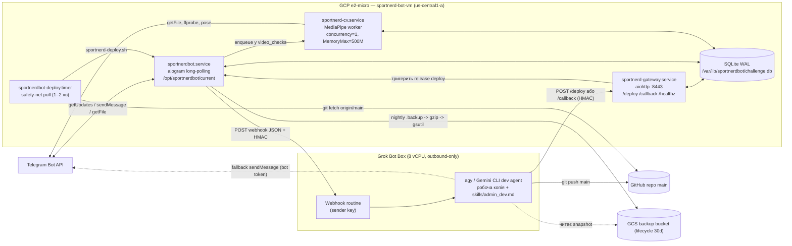
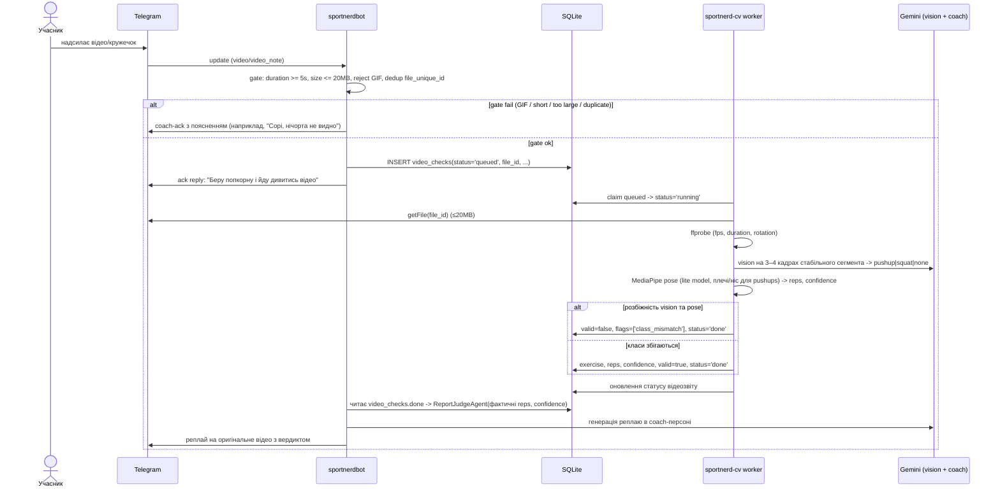
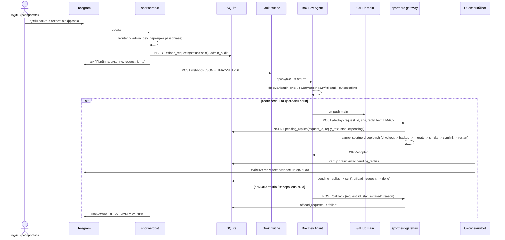

# SportNerdBot — Target Architecture

> Статус: Офіційна архітектура проєкту SportNerdBot (станом на 2026-10-20).
> Базується на рішенні з `optionToConsider/ARCHITECTURE.md` та `optionToConsider/PLANNING_BRIEF.md`,
> реалізованому у фазах 0–5.

---

## 1. Архітектурні принципи та межі

- **Один polling-процес як джерело правди:** Telegram-трафік обслуговується єдиним процесом `sportnerdbot.service` (`aiogram` long-polling). Відповідно до обмеження Telegram Bot API, другий процес з тим самим токеном отримує помилку `409 Conflict`.
- **Pull-based деплой через релізи та атомарний symlink:** Замість небезпечного перезапису робочого каталогу, кожен деплой створює окрему директорію `/opt/sportnerdbot/releases/<sha>` і атомарно перемикає symlink `/opt/sportnerdbot/current`.
- **Відокремлення даних від коду:** SQLite БД винесена з каталогу коду в `/var/lib/sportnerdbot/challenge.db`, працює в режимі `WAL` із `busy_timeout=5000` та `PRAGMA foreign_keys=ON`.
- **Безпека (Non-root & Hardening):** Усі сервіси працюють під системним non-root користувачем `sportnerd`. Використовується systemd hardening (`ProtectSystem=strict`, `NoNewPrivileges=yes`, обмеження пам'яті `MemoryMax`).
- **Офлоад важких операцій на Grok Bot Box:** Важкі задачі розробки коду (`admin_dev`), зміна промптів та складні CV-задачі офлоадяться на Grok Bot Box через підписані HMAC-SHA256 вебхуки. Швидкі операції зі зміни параметрів челенджу (`admin_quick`) лишаються всередині бота.
- **Git як єдине джерело правди:** Будь-які persistent-зміни схеми, коду та системних промптів фіксуються через коміти в git і версіоновані міграції (`migrations/`).
- **Захист секретів:** Секрети ніколи не передаються у вебхуках і не зберігаються в git. На VM конфігурація зчитується з `/etc/sportnerdbot/env` (права `0600`, власник `sportnerd`), на box — з локального `.env` (gitignored).

---

## 2. Компонентна архітектура



### Основні інформаційні потоки:
1. **Чат та звичайні повідомлення:** `Telegram <-> sportnerdbot.service` (обробка під монотонним курсором `(created_at, chat_history.id)`).
2. **Відеозвіти (локальний конвеєр):** `bot.py` виконує перевірку (gate) -> запис у `video_checks` -> `sportnerd-cv.service` завантажує відео (≤20MB), викликає Gemini vision (3–4 кадри) та MediaPipe Pose -> запис результату -> `ReportJudgeAgent` -> публікація реплаю.
3. **Відеозвіти (offload):** Довгі або ресурсомісткі відео передаються через webhook на Box -> повернення результату через `POST /callback` на gateway.
4. **admin_dev потік:** Запит адміна з кодовою фразою -> Router виділяє `admin_dev` -> швидкий ack адміну (`request_id`) -> відправка webhook на Box -> агент на Box реалізує зміни, валідує тести, робить git push -> викликає `POST /deploy` на gateway -> атомарний switch релізу -> новий процес надсилає збережений у `pending_replies` результат.

---

## 3. Sequence діаграми

### 3.1 Відеозвіт (асинхронна верифікація)



### 3.2 admin_dev потік (запит -> Box -> deploy -> відповідь)



### 3.3 Деплой із автоматичним відкатом (Release-dir + atomic symlink)

```mermaid
sequenceDiagram
  participant TRIG as Тригер (gateway /deploy АБО deploy.timer)
  participant DEP as deploy/deploy.sh
  participant GH as GitHub
  participant MIG as database.migrate
  participant DB as SQLite
  participant SYS as systemd

  TRIG->>DEP: deploy(sha | origin/main)
  DEP->>GH: git fetch --all
  DEP->>DEP: git checkout / archive -> releases/<sha>
  DEP->>DEP: оновлення venv (якщо змінився hash requirements.txt)
  DEP->>DB: online backup: sqlite3 .backup -> backups/<ts>.db
  DEP->>MIG: застосування міграцій до HEAD (expand-only)
  alt помилка міграції
    MIG-->>DEP: failure
    DEP->>DEP: збереження поточного symlink, вихід із помилкою
  else міграції успішні
    DEP->>DEP: smoke: import bot; bot.build_app() + pytest -m offline
    alt smoke fail
      DEP->>DEP: статус failed, symlink не змінюється
    else smoke ok
      DEP->>DEP: PREV=$(readlink current); ln -sfn releases/<sha> current
      DEP->>SYS: systemctl restart sportnerdbot
      DEP->>SYS: health check (is-active + перевірка логу / healthz)
      alt health check fail
        DEP->>DEP: відкат: ln -sfn $PREV current
        DEP->>SYS: systemctl restart sportnerdbot
        DEP->>DEP: запис статусу rolled_back
      else health check ok
        DEP->>DEP: видалення старих релізів (зберігаються останні 5), статус ok
      end
    end
  end
```

---

## 4. Файлова структура сервера та Systemd

### 4.1 Структура файлової системи на VM

```
/opt/sportnerdbot/
  releases/<git_sha>/        # Незмінний код кожного релізу (код, prompts.py, migrations/)
  current -> releases/<sha>  # Атомарний symlink на активний реліз
  venv/                      # Спільне віртуальне оточення Python (кешується)
  shared/                    # Загальні статичні файли (медіа-заготовки, obey_media_dir)
/etc/sportnerdbot/
  env                        # Файл змінних оточення (0600, власник sportnerd:sportnerd)
/var/lib/sportnerdbot/
  challenge.db               # SQLite база даних у режимі WAL (поза release dir)
  challenge.db-wal / -shm    # WAL-файли SQLite
  backups/<timestamp>.db     # Бекапи перед кожною міграцією та nightly
  deploy_status/             # JSON-файли зі статусами кожного деплою
/usr/local/bin/
  sportnerd-deploy.sh -> /opt/sportnerdbot/current/deploy/deploy.sh
```

### 4.2 Systemd сервіси

| Unit | Призначення | Ключові параметри безпеки та ресурсів |
|---|---|---|
| `sportnerdbot.service` | Основний aiogram long-polling процес | `User=sportnerd`, `WorkingDirectory=/opt/sportnerdbot/current`, `EnvironmentFile=/etc/sportnerdbot/env`, `Restart=always`, `NoNewPrivileges=yes`, `ProtectSystem=strict`, `ReadWritePaths=/var/lib/sportnerdbot /opt/sportnerdbot`, `MemoryMax=550M` |
| `sportnerd-cv.service` | Асинхронний MediaPipe CV воркер | `User=sportnerd`, `Nice=10`, `MemoryMax=500M`, `CPUWeight=50`, concurrency=1 |
| `sportnerd-gateway.service` | HTTP aiohttp API (`/deploy`, `/callback`, `/healthz`) | `User=sportnerd`, `MemoryMax=80M`, слухає loopback + `:8443` |
| `sportnerdbot-deploy.timer` + `.service` | Періодичний pull з origin/main (safety net) | `User=sportnerd`, oneshot виклик `sportnerd-deploy.sh` кожні 1–2 хвилини |

---

## 5. База даних та версіоновані міграції

### 5.1 Таблиці бази даних

1. `schema_version`: Відстеження застосованих міграцій (`version`, `name`, `applied_at`).
2. `users`: Спортивні профілі учасників (`slug`, `full_name`, `telegram_id`, `aliases`, `active`).
3. `user_progress`: Зарахування виконання норми за днями (`date`, `user_slug`, `done`, `source`, `note`, `updated_at`).
4. `progress`: Застаріла (legacy) таблиця з колонками `lyosha_done`/`sasha_done`. Зберігається у режимі **read-only** для сумісності; нові записи йдуть виключно в `user_progress`.
5. `chat_history`: Історія повідомлень чату для формування контексту.
6. `bot_state`: Системний стан (курсори `last_processed_timestamp`, `last_processed_id`).
7. `prompts` та `prompt_history`: Тексти системних промптів та історія їхніх версій.
8. `pending_replies`: Черга повідомлень, які мають бути гарантовано надіслані після перезапуску бота (`request_id`, `chat_id`, `reply_to_message_id`, `text`, `status`, `attempts`).
9. `video_checks`: Черга та результати CV-аналізу відеозвітів (`request_id`, `file_id`, `file_unique_id`, `duration_s`, `exercise`, `reps`, `confidence`, `flags`, `valid`, `status`, `analyzer_version`).
10. `offload_requests`: Журнал завдань, делегованих на Grok Bot Box (`request_id`, `type`, `status`, `payload`, `commit_sha`, `expires_at`).
11. `admin_audit`: Аудит адмін-запитів (`request_id`, `author_slug`, `request`, `plan`, `commit_sha`, `status`).

### 5.2 Стратегія міграцій
- Runner: `python -m database.migrate --db <path>`.
- Формат файлів міграцій: `migrations/NNNN_name.sql` або `migrations/NNNN_name.py` (з функцією `upgrade(conn)`).
- **Expand-only політика:** Заборонено виконання небезпечних деструктивних операцій (`DROP TABLE`, `DROP COLUMN`) під час регулярних релізів, щоб старий код залишався працездатним при аварійному відкаті (rollback).
- Автоматичний online-бекап (`sqlite3 .backup`) у `/var/lib/sportnerdbot/backups/<ts>.db` перед виконанням кожної транзакції міграцій.

---

## 6. Версіоновані JSON-контракти (v1.0)

Усі міжсервісні контракти містять обов'язкове поле `"contract_version": "1.0"` та автентифікуються за допомогою HMAC-SHA256 підпису з перевіркою часового вікна (timestamp window ±5 хвилин).

### 6.1 Запит: bot -> Grok routine webhook
```json
{
  "contract_version": "1.0",
  "request_id": "c1f71a9b-4b2e-4b6b-bf6c-7f5195155f30",
  "type": "admin",
  "created_at": "2026-10-20T20:47:00+03:00",
  "chat_id": -1004481392380,
  "message_id": 4567,
  "reply_to_message_id": 4560,
  "user": {
    "telegram_id": 111,
    "username": "admin_user",
    "slug": "sasha"
  },
  "payload": {
    "text": "Зміни цільовий норматив для Саші на 20",
    "referenced_text": "Попередній норматив: 14",
    "recent_messages": ["..."]
  },
  "file_id": null,
  "file_unique_id": null,
  "reply_mode": "callback",
  "ts": 1760982420,
  "signature": "hmac-sha256(hex, body || ts, ROUTINE_SHARED_SECRET)"
}
```

### 6.2 Callback: Box -> Gateway `/callback`
```json
{
  "contract_version": "1.0",
  "request_id": "c1f71a9b-4b2e-4b6b-bf6c-7f5195155f30",
  "status": "done",
  "result": {
    "summary": "Норматив оновлено через міграцію 0008"
  },
  "commit_sha": "d7a4f91",
  "reply_text": "Норматив успішно оновлено: тепер 20 відтискань на день!",
  "ts": 1760982500,
  "signature": "hmac-sha256(hex, body || ts, GATEWAY_HMAC_SECRET)"
}
```

### 6.3 Результат відеоаналізу (`analyze_video`)
```json
{
  "contract_version": "1.0",
  "request_id": "v-98a2-4a0e",
  "file_unique_id": "AQADAgAD",
  "duration_s": 42.5,
  "exercise": "pushup",
  "reps": 25,
  "confidence": 0.88,
  "vision_class": "pushup",
  "pose_class": "pushup",
  "flags": [],
  "valid": true,
  "analyzer_version": "cv-1.0",
  "elapsed_s": 14.2
}
```

### 6.4 Запит на деплой: Box -> Gateway `/deploy`
```json
{
  "contract_version": "1.0",
  "request_id": "d-531a-4c28",
  "sha": "d7a4f91",
  "chat_id": -1004481392380,
  "reply_to_message_id": 4567,
  "reply_text": "Оновлення розгорнуто, функціонал активовано.",
  "ts": 1760982600,
  "signature": "hmac-sha256(hex, body || ts, GATEWAY_HMAC_SECRET)"
}
```

---

## 7. Рішення по відкритих питаннях

- **Downtime при перезапуску:** Прийнято плановий короткий restart window (10–30 с). Telegram надійно зберігає вхідні повідомлення до 24 годин. Для запобігання втраті відповідей використовується таблиця `pending_replies`.
- **Основний та резервний деплой-механізм:** Основний шлях — миттєвий виклик `sportnerd-gateway` (`POST /deploy`), резервний safety-net — таймер `sportnerdbot-deploy.timer` (1–2 хвилини).
- **Direct push у main для admin_dev з guardrails:**
  - *Дозволено без ручного підтвердження:* Зміни даних БД через data-migrations, системні промпти, допоміжний код агентів за умови проходження офлайн-тестів (`pytest`).
  - *Заборонені зони (вимагають команди `/approve <request_id>`):* Зміни файлів конфігурації `.env`, скриптів каталогу `deploy/`, systemd-юнітів, деструктивні SQL-операції.
- **Джерело правди для промптів:** Git-міграції. Механізм `prompt_editor.py` слугує лише аварійним fallback у разі недоступності Box-агента.
- **Обмеження пам'яті та swap:** Для e2-micro налаштовується 1–2 GB swap та директиви `MemoryMax` для кожного сервісу, щоб гарантувати стабільність бота при запуску CV-воркера.

## Box CV offload (long-poll)

CV-підрахунок відео винесено з e2-micro VM на Grok Bot box (у box немає вхідних з'єднань, тому box сам тягне задачі).

- **VM (bot):** відео -> `video_checks(status='offloaded')` + `cv_jobs(status='queued')`, одна відповідь `processing` (з `bot_texts`). Scheduler кожні 10 с (`ChatFlow.process_cv_results`) відповідає на `done/failed` (judge + Gemini-тон як раніше) і один раз шле `still_counting`, якщо результату немає довше `CV_STILL_COUNTING_MIN` (5 хв). Ніколи не просить переробити підхід.
- **VM (gateway, `gateway/cv_queue.py`):** `POST /cv/claim` — long-poll до `CV_CLAIM_WAIT_S` (25 с), 200 з job або 204; `GET /cv/jobs/{id}/video` — відео (gateway качає його з Telegram на claim у `CV_VIDEO_DIR`, видаляє після done/failed); `POST /cv/jobs/{id}/result` — `{claim_token, ok, result, timings, error}`. Lease `CV_LEASE_S` (300 с): прострочений claim -> requeue, після 3 спроб -> failed.
- **Auth:** кожен запит підписаний HMAC (`core.signing.sign_request`): `METHOD\nPATH\nTS\nNONCE\nsha256(body)`, заголовки `X-SN-Ts/X-SN-Nonce/X-SN-Signature`, вікно ±5 хв + одноразовий nonce (replay -> 401). Секрет — існуючий `GATEWAY_HMAC_SECRET`.
- **Box worker (`cv_worker/box_worker.py`):** env `CV_GATEWAY_URL`, `CV_HMAC_SECRET_ENV` (назва змінної, default `GATEWAY_HMAC_SECRET`), `CV_ENV_FILE`. Після 204 одразу новий claim; backoff лише на помилках 1/2/5/10/20/30 с. Кожен job: `heavy --who SportNerdBot-CV --max 600 python -m cv_worker.cv_job <video> <out.json>` (15 fps, мін. 12; 640px). Запуск: `nohup cv_worker/run_box_worker.sh >/dev/null 2>&1 &` (supervisor-цикл, pidfile `/tmp/sportnerd-boxcv.pid`; у box немає systemd --user/cron — після рестарту box запустити знову). Залежності на box: `pip install -r requirements-cv.txt` + apt `libegl1 libgles2`.
- **VM deps:** `deploy.sh` за замовчуванням `INSTALL_CV=0` (без mediapipe). `sportnerd-cv.service` на VM вимкнути: `systemctl disable --now sportnerd-cv`.
- **Мережа:** gateway має бути доступний з box: публічний HTTPS (reverse proxy з TLS -> 127.0.0.1:8443, `proxy_read_timeout >= 60s`, `proxy_buffering off` для /cv/claim) і firewall-правило лише на цей порт. aiohttp `keepalive_timeout=75`.
