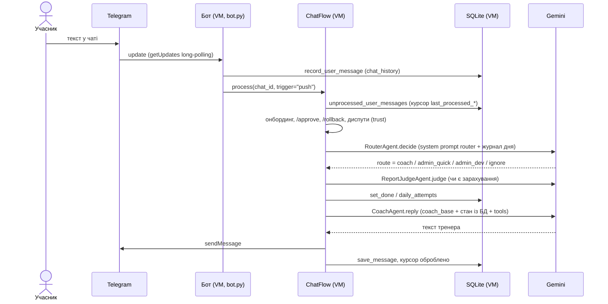
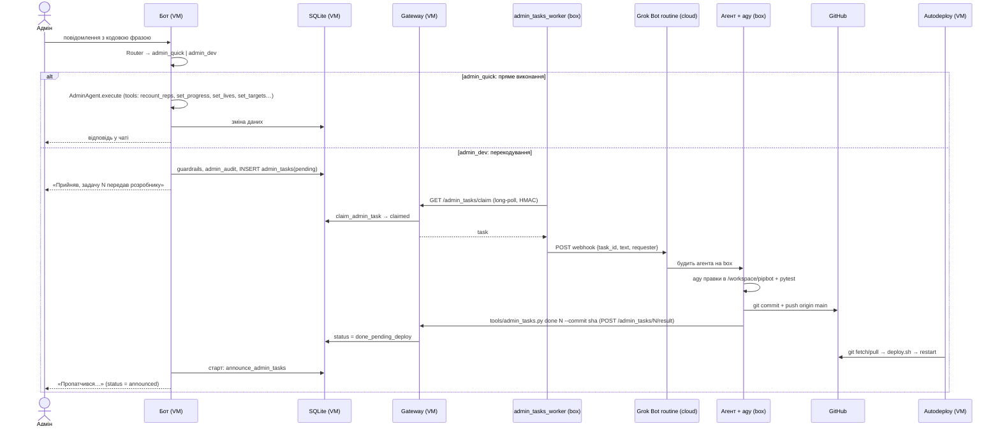
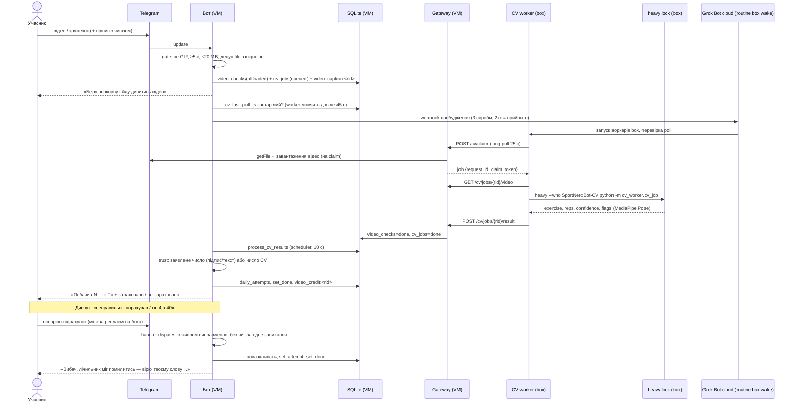
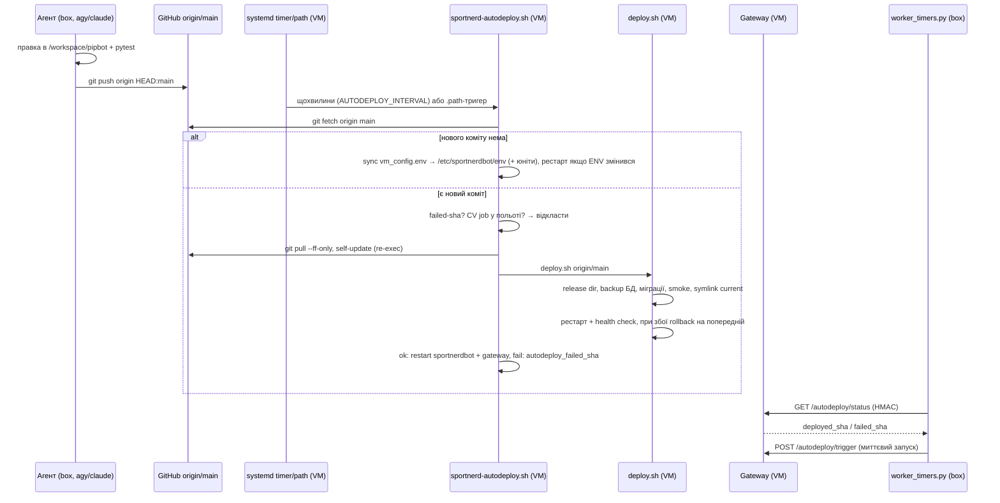

# SportNerdBot — потоки (flows)

> Поточний стан за реальним кодом. Компоненти та терміни — у [`SPEC.md`](SPEC.md). Для кожного кроку вказано **хто** його
> запускає (user / Telegram / bot process / gateway / box worker / Grok Bot routine / agy / timer), **де** він виконується
> (Telegram / VM / box / GitHub / Grok Bot cloud) і **файл/функцію**.

Скорочення місць: **VM** = GCP `sportnerd-bot-vm`; **box** = віддалена Linux-машина Grok Bot (персистентний хмарний комп'ютер агентів).

---

## A. Звичайне текстове повідомлення

| # | Крок | Хто запускає | Де | Файл / функція |
|---|---|---|---|---|
| 1 | Користувач пише в чат | user | Telegram | — |
| 2 | Update отримує aiogram, повідомлення пишеться в `chat_history` | Telegram → bot process | VM | `bot.py: on_message` → `ChatFlow.record_user_message` |
| 3 | Обробка черги непрочитаних повідомлень під `asyncio.Lock` (курсор `last_processed_timestamp/id`) | bot process | VM | `app/flow.py: process` |
| 4 | Автори без запису в БД створюються як `uninitialized` → онбординг | bot process | VM | `_handle_pending`, `agents/onboarding.py` |
| 5 | `/approve`, `/rollback` у тексті — окремі гілки | bot process | VM | `handle_approve`, `handle_rollback` |
| 6 | Trust-режим: перехоплення диспутів про підрахунок відео (див. C) | bot process | VM | `_handle_disputes` |
| 7 | Router: LLM класифікує `admin / admin_quick / admin_dev / coach / ignore`; адмін-маршрут дозволений лише за реальної кодової фрази (`_guard`), при недоступності Gemini — детермінований `fallback` за ключовими словами | bot process → Gemini | VM → Gemini | `agents/router.py: RouterAgent.decide` |
| 8 | Prompt assembly для coach: `coach_base` (промпт з таблиці `prompts` або `DEFAULT_PROMPTS`) + плейсхолдери (дата, день, вправа, норми/статус/XP/життя з БД) + `coach_dynamic` (правила від адміна) + журнал чату за день + нотатки судді | bot process | VM | `agents/coach.py: build_system_prompt`, `reply`; `prompts.py` |
| 9 | Judge: LLM вирішує, чи повідомлення є звітом; відео-докази ігноруються (їх судить CV/trust); fallback — евристика | bot process → Gemini | VM → Gemini | `agents/report_judge.py`, `flow._handle_coach`, `_apply_verdict` |
| 10 | Tools моделі (AFC): `get_random_anime_quote`, `get_challenge_rules`, `get_chat_members_info` | Gemini викликає | VM | `agents/coach.py: reply` |
| 11 | Відповідь у чат; при збої LLM — шаблонна відповідь | bot process | VM → Telegram | `_say`, `_template_reply`, `core/llm.py` (rate-limit, перебір моделей) |

---

## B. Адмін-режим

Код-фраза (`ADMIN_PASSPHRASE_MARKERS`, напр. «Obey me») у повідомленні + Telegram ID в `ADMIN_TELEGRAM_IDS`
(`core/guardrails.py: is_admin_allowed`). Два рівні: **admin_quick** (дані міняє сам бот) і **admin_dev** (потрібен код → розробник на box).

| # | Крок | Хто запускає | Де | Файл / функція |
|---|---|---|---|---|
| 1 | Повідомлення з фразою; роутер визначає tier (`classify_admin_tier`: ключові слова dev/quick) | user → bot process | VM | `agents/router.py` |
| 2 | Перевірка allowlist (`ADMIN_TELEGRAM_IDS`) | bot process | VM | `core/guardrails.py` |
| **B1** | **Пряме виконання (admin_quick).** Відео «obey», `AdminAgent.execute`: Gemini з tools змінює дані: `set_lives`, `set_targets`, `set_schedule`, `swap_today_exercise`, `recount_reps`, `set_progress`, `update_user_profile`, `set_counter`, `update_coach_prompt`, `set_bot_text`… | bot process → Gemini | VM | `flow._handle_admin_quick`, `agents/admin.py` |
| B1a | Якщо немає потрібного тула — модель викликає `create_admin_task` (нова задача розробнику) | Gemini → bot process | VM | `agents/admin.py: create_admin_task` |
| **B2** | **Перекодування (admin_dev).** Guardrails: rate-limit (`ADMIN_DEV_RATE_LIMIT_HOUR`), не більше одного активного запиту; запис в `admin_audit` | bot process | VM | `flow._handle_admin_dev`, `core/guardrails.py` |
| B3 | `INSERT admin_tasks(status=pending)`, ack адміну | bot process | VM | `Store.create_admin_task`, текст `admin_dev_accepted` |
| B4 | Long-poll claim (`GET /admin_tasks/claim`, до 25 с), задача → `claimed` | box worker → gateway | box → VM | `tools/admin_tasks_worker.py: step`, `gateway/admin_tasks_api.py: handle_claim` |
| B5 | Доставка в webhook із повторами, поки не 2xx (`ADMIN_TASKS_WEBHOOK_URL/KEY`); без налаштованого вебхука задачі **не** claim-яться | box worker | box → Grok Bot cloud | `AdminTasksWorker.deliver` |
| B6 | Routine будить агента на box з payload `{task_id, text, requester, created_at}` | Grok Bot routine | Grok Bot cloud → box | (налаштування routine «SportNerdBot admin task») |
| B7 | Агент працює за `skills/admin_dev.md`: формалізація, правки через `agy` (`--model gemini-3.8-flash-high`; `claude` — fallback), міграції для даних/промптів | агент | box | `skills/admin_dev.md` |
| B8 | Тести `pytest` (CPU-важке — через `heavy`), commit, `git push origin HEAD:main` | агент | box → GitHub | repo |
| B9 | Закриття: `python tools/admin_tasks.py done <id> --commit <sha> --note …` або `reject <id> --note …` → `POST /admin_tasks/{id}/result` | агент → gateway | box → VM | `tools/admin_tasks.py`, `handle_result` |
| B10 | Autodeploy викочує коміт (див. D) | timer / path | VM | `deploy/autodeploy/sportnerd-autodeploy.sh` |
| B11 | Після рестарту бот анонсує задачі `done_pending_deploy`, чий `fix_commit` входить у реліз (`REVISION_COMMITS`) → «Пропатчився…», `announced`; `rejected` — «відхилено»; довгі задачі раз на `ADMIN_TASK_STALE_HOURS` — «ще в роботі» | bot process (scheduler, `ADMIN_TASKS_ANNOUNCE_INTERVAL_SEC`) | VM → Telegram | `flow.announce_admin_tasks` |

Захищені зони (`.env*`, `deploy/*`, systemd-юніти, деструктивні міграції) за `skills/admin_dev.md` вимагають `/approve <request_id>` від адміна.

---

## C. Відеозвіт

> Нормативні деталі черги `cv_jobs`, пробудження box, lease/ретраїв, ідемпотентності результату й збоїв — у
> [`SPEC_VM_BOX_INTERACTION.md`](SPEC_VM_BOX_INTERACTION.md).

| # | Крок | Хто запускає | Де | Файл / функція |
|---|---|---|---|---|
| 1 | Відео/кружечок у чаті | user | Telegram | — |
| 2 | Gate: відхиляє GIF, <5 с, >20 MB, дублікат за `file_unique_id` («хеш-дедуп»); підпис зберігається в `bot_state: video_caption:<rid>` | Telegram → bot process | VM | `bot.py: on_message` → `flow.handle_video` |
| 3 | `video_checks(status=offloaded, location=box)` + `enqueue_cv_job`; відповідь `processing` | bot process | VM | `Store.create_video_check`, `enqueue_cv_job` |
| 3a | **Wake box:** якщо `cv_last_poll_ts` старший за `WAKE_STALE_S` (45 с) і немає `claimed` job у межах lease — вебхук Grok Bot routine «SportNerdBot box wake» (3 спроби, backoff 2/5/10 с, будь-який 2xx = прийнято), чекання до `WAKE_WAIT_S` (90 с) на свіжий `/cv/claim`, за потреби ще раунд. Job лишається `queued` увесь час. Якщо worker не прокинувся — **одне** повідомлення `box_waking` на епізод; watchdog (раз на хв, вебхук не частіше ніж раз на 5 хв) продовжує, поки job висить. Без секрету / `WAKE_ENABLED=0` — no-op | bot process (VM) → Grok Bot cloud → box | VM → Grok Bot cloud webhook → box | `core/wake.py: BoxWaker.ensure_awake/watchdog`, `flow._ensure_box_awake` |
| 4 | Long-poll claim; gateway підтягує відео з Telegram (box не знає `BOT_TOKEN`); lease `CV_LEASE_S` | box worker → gateway | box → VM → Telegram | `cv_worker/box_worker.py`, `gateway/cv_queue.py: handle_claim` |
| 5 | Завантаження відео | box worker | box ← VM | `GET /cv/jobs/{rid}/video` |
| 6 | CV під lock-ом `heavy` (одна важка задача на box): MediaPipe Pose по кадрах відео → exercise/reps/confidence/flags (Gemini-vision `cv_worker/vision.py` у box-шляху не викликається) | box worker | box (+ Gemini) | `heavy_cv_command`, `cv_worker/cv_job.py`, `core/cv/rep_counter.py: analyze_video` |
| 7 | Результат `{claim_token, ok, result}` → `video_checks=done`, `cv_jobs=done` | box worker → gateway | box → VM | `POST /cv/jobs/{rid}/result`, `Store` |
| 8 | Якщо результату довше `CV_STILL_COUNTING_MIN` (5 хв) — раз «Ще рахую» | timer (APScheduler, 10 с) | VM | `flow.process_cv_results` |
| 9 | **Trust-кредит:** claim = число з підпису → інакше текст автора за 10 хв до відео → інакше CV. Зараховано `credited`; день `done` ⇔ `credited ≥ target`; менше — лише спроба. Відповідь із `trust_*` (без перефразу Gemini). Зберігається `video_credit:<rid>` | bot process | VM | `flow._handle_video_callback_trust`, `core/claims.py` |
| 9′ | Якщо `TRUST_MODE=0`: суддя `judge_video_fact` (valid, confidence ≥ 0.6, вправа збігається, reps ≥ target) + перефраз Gemini | bot process | VM | `flow.handle_video_callback`, `agents/report_judge.py` |
| 10 | **Диспут:** слова-маркери («неправильно», «помилився», «зарахуй», «не 4 а 40», «я зробив більше») або реплай на повідомлення бота. З числом — `_apply_video_correction`: нова кількість стає перемогою (вища чи нижча за CV), `set_attempt` + `set_done(best ≥ target)`, відповідь `trust_dispute_fix`. Без числа — один раз `trust_dispute_ask` (стан `dispute_wait:<slug>`), наступне число зараховується. Працює після відповіді бота і для відео, зарахованого раніше **того ж дня челенджу** | user → bot process | VM | `flow._handle_disputes`, `_apply_video_correction`, `core/claims.py: is_dispute/parse_dispute_reps` |
| 11 | XP, життя та нова норма не нараховуються тут — лише в підсумку дня (`settle`, 02:30) від `best_reps`; тому подвійного XP немає | timer | VM | `flow._settle_lives`, `core/progression.py` |

**День відео:** `flow._video_day` бере день челенджу за часом надходження відео (не обробки): якщо результат прийшов після rollover (02:30), спроба все одно йде в день, коли відео надіслали.

**Обмеження box:** якщо box у простої призупинений, воркер не поллить — відео лишається `queued` у `cv_jobs`, бот пише «ще рахую»,
результат прийде після пробудження (або lease поверне job у чергу). Автодеплой також відкладає викочування, поки є
`queued/claimed` CV-job. Тому VM сама будить box (крок 3a); якщо вебхук недоступний чи секрет не налаштований, відео просто
чекає в черзі — нічого не губиться.
Диспут про відео вже підсумованого дня (після 02:30) не обробляється — потрібен відкат XP/життів; такі випадки правляться адміном (`recount_reps`/`set_progress`).

---

## D. Патч і деплой

| # | Крок | Хто запускає | Де | Файл / функція |
|---|---|---|---|---|
| 1 | Правки через `agy -p … --model gemini-3.8-flash-high --add-dir /workspace/pipbot` (trivial — вручну; `claude` — fallback), перегляд diff | агент | box | репо `/workspace/pipbot` |
| 2 | Офлайн-тести `.venv/bin/python -m pytest -q`; важкі задачі — через `heavy --who …` | агент | box | `tests/` |
| 3 | `git commit` + `git push origin HEAD:main` | агент | box → GitHub | — |
| 4 | Таймер `sportnerd-autodeploy.timer` (інтервал із `AUTODEPLOY_INTERVAL`, 1 хв) та `.path` (зміна `/var/lib/sportnerdbot/autodeploy_trigger`) запускають oneshot-сервіс | systemd timer | VM | `deploy/autodeploy/*` |
| 5 | `flock`-замок; `git fetch`; якщо `origin/main` == `current/REVISION` — лише синхронізація `deploy/vm_config.env` у `/etc/sportnerdbot/env` (крім захищених ключів: токени, `GATEWAY_HMAC_SECRET`, `DB_PATH`, `AUTODEPLOY_INTERVAL`…) і рестарт при зміні; оновлення юнітів/таймера/`.path`/sudoers | autodeploy | VM | `sync_vm_config_and_units` |
| 6 | Пропуск, якщо SHA вже у `autodeploy_failed_sha`; **відкладення**, якщо в `cv_jobs` є `queued/claimed` | autodeploy | VM | `sportnerd-autodeploy.sh` |
| 7 | `git pull --ff-only`, **self-update**: повторний запуск оновленого скрипта (`AUTODEPLOY_REEXEC=1`) | autodeploy | VM | там само |
| 8 | `deploy.sh origin/main`: release-dir `/opt/sportnerdbot/releases/<sha>` (+`REVISION`, `REVISION_COMMITS`), backup БД, міграції, smoke, атомарний symlink `current`, restart, health-check; при збої — автоматичний rollback на попередній symlink | autodeploy | VM | `deploy/deploy.sh` |
| 9 | Успіх → `systemctl restart sportnerdbot sportnerd-gateway`; збій → SHA у `/var/lib/sportnerdbot/autodeploy_failed_sha`, повторів нема | autodeploy | VM | там само |
| 10 | Перевірка з box: `python tools/worker_timers.py status --remote` (HMAC `GET /autodeploy/status`) — порівняти `deployed_sha` з комітом; `trigger-deploy` (`POST /autodeploy/trigger`) — не чекати таймер | агент | box → VM | `tools/worker_timers.py`, `gateway/admin_tasks_api.py` |
| 11 | Живі інтервали поллінгу воркерів: `config/workers.env` (читається щоразу); VM-параметри: `deploy/vm_config.env` (потрапляє на VM автодеплоєм) | агент | box (git) → VM | `tools/worker_timers.py set` |
| 12 | **Відкат:** автоматичний у `deploy.sh` при збої health-check; ручний — `/rollback` в чаті (адмін; `deploy.sh rollback`) або `sudo -u sportnerd /usr/local/bin/sportnerd-deploy.sh rollback`; відкат коміту в git → новий push | admin / оператор | VM | `flow.handle_rollback`, [`RUNBOOK.md`](RUNBOOK.md) |

---

## E. Відпустка/лікарняний (leaves)

Повний життєвий цикл статусу відпустки або лікарняного: оголошення, щоденна активність, взаємодія з розрахунком та завершення.

| # | Етап | Дія / Механізм | Результат |
|---|---|---|---|
| 1 | **Оголошення** | Команда адміну в чаті («Льоша захворів», «Саша у відпустці з 01.11 до 10.11») або виклик через Gateway `/admin/ops` `set_leave`. | Створюється запис у таблиці `leaves` із нормалізованим `kind` ('sick' або 'vacation'). Якщо є активний перетин — попередній запис обрізається або скасовується. |
| 2 | **Ранковий статус** | Morning-таймер формує `norms_lines` через `flow._handle_timer`. | Біля учасника додається позначка `(🤒 на лікарняному)` або `(🏖 у відпустці)`. |
| 3 | **Нагадування протягом дня** | Чек-пойнти (15:00, 19:00, 23:30) викликають `missing_participants`. | Учасник не потрапляє до списку боржників; бот не тегає і не лає його. |
| 4 | **Запит статусу** | Команда `/status` або виклик `challenge.status_text`. | Замість `НЕ виконано ❌` виводиться `🤒 на лікарняному (до DD.MM)` або `🏖 у відпустці (до DD.MM)`. Життя, XP та рівень зберігаються. |
| 5 | **Підсумок дня (`settle`)** | Нічний розрахунок о 02:30 (Київ): `settle_missed_day` та `settle_progression`. | `settle_missed_day` **не знімає** життя. Якщо учасник не виконував норму — `settle_progression` повністю пропускає його (норма не спадає, XP без змін). Якщо виконав сам — нараховується звичайний прогрес. |
| 6 | **Звіт у чат** | Метод `flow._settle_lives` надсилає підсумок дня. | Додається рядок `🤒 {name} на лікарняному — життя й норма без змін` або `🏖 {name} у відпустці — життя й норма без змін`. |
| 7 | **Завершення** | Настання дати `end_date` (автоматично перестає бути активною) або виклик `end_leave` (зменшує `end_date = from_day - 1`). | З дня `from_day` учасник знову стає активним боржником денної норми. |
