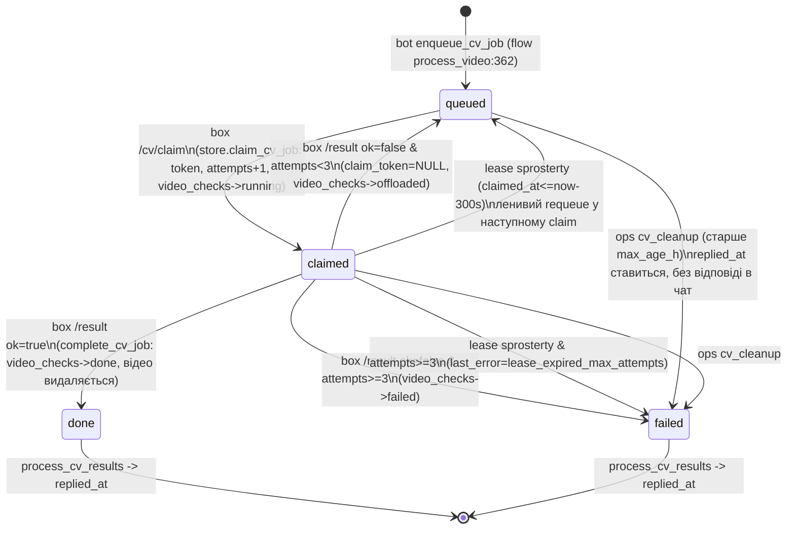
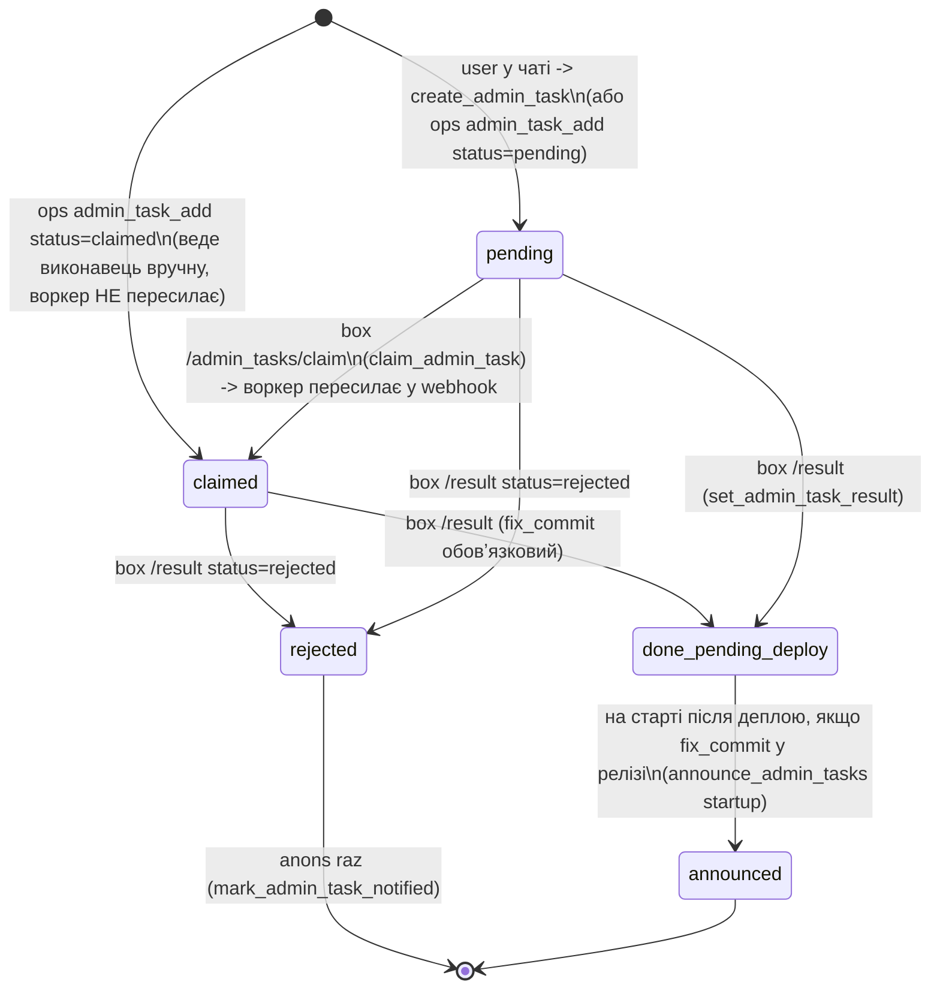
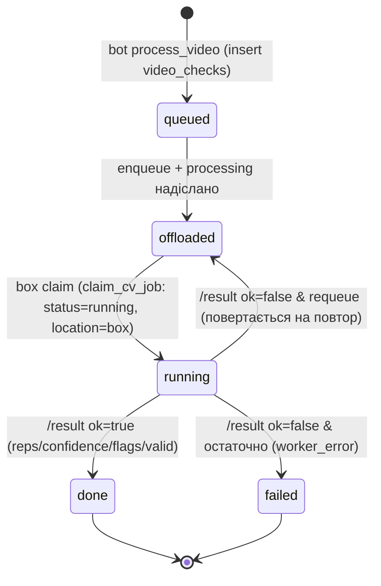
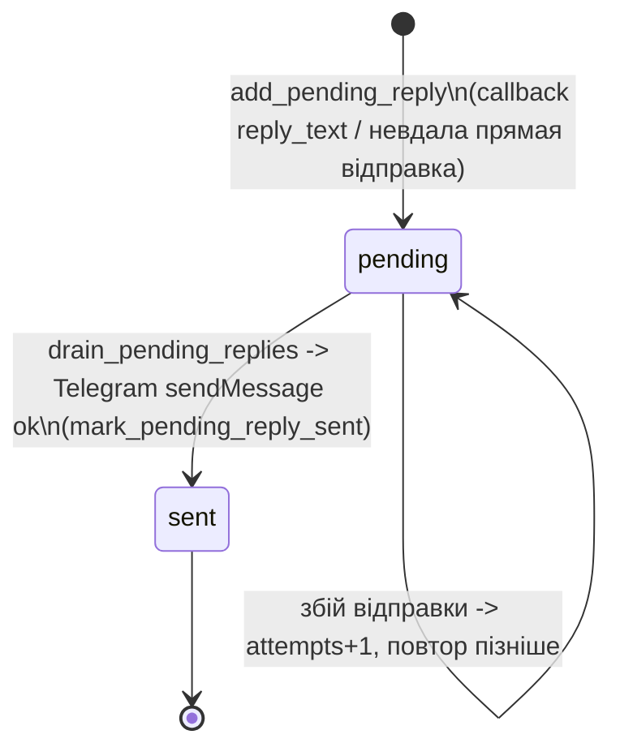
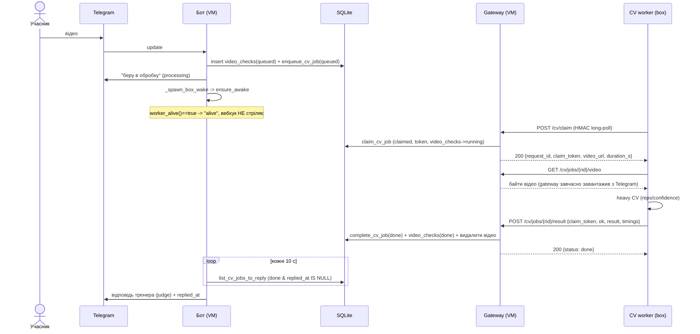
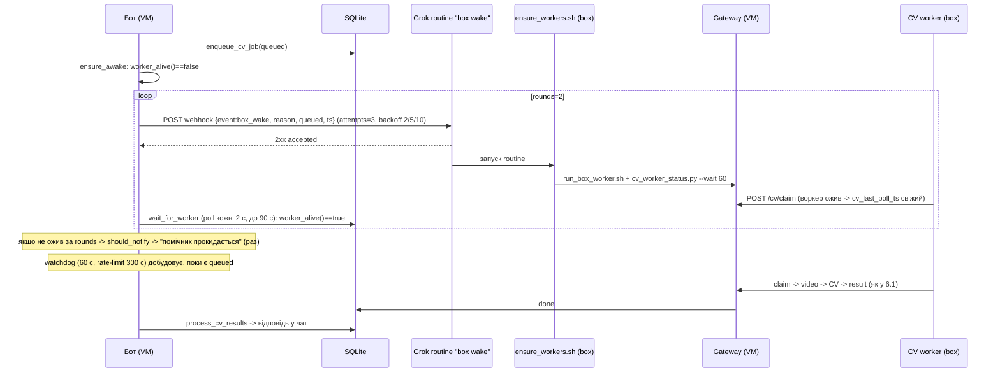
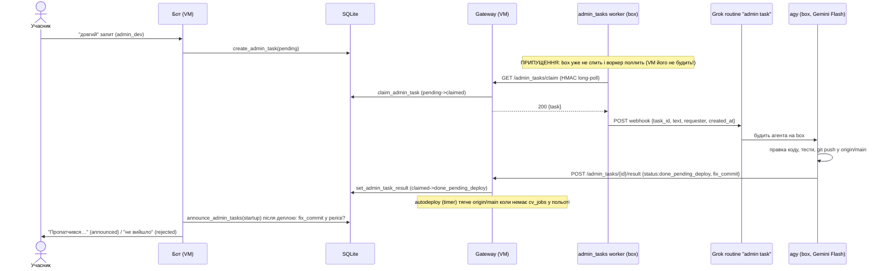

# SportNerdBot — нормативна специфікація взаємодії VM ↔ box

> **Статус:** нормативний документ (MUST/SHOULD) + звірка з реальним кодом станом на 2026-10-26. Описує, як VM (GCP
> `sportnerd-bot-vm`) делегує обчислення й задачі на **box** (ефемерна Linux-машина Grok Bot) і як вони обмінюються
> результатами. Загальний контекст — у [`SPEC.md`](SPEC.md); покрокові потоки чату — у [`FLOWS.md`](FLOWS.md);
> експлуатація — у [`RUNBOOK.md`](RUNBOOK.md). Промпт, за яким цей файл дописується/перевіряється:
> [`SPEC_VM_BOX_INTERACTION_PROMPT.md`](SPEC_VM_BOX_INTERACTION_PROMPT.md).
>
> **Секрети** (`GATEWAY_HMAC_SECRET`, `BOT_TOKEN`, ключі вебхуків `WAKE_WEBHOOK_KEY`, `ADMIN_TASKS_WEBHOOK_KEY`, URL
> вебхуків) у git і в цьому документі **не наводяться** — лише назви змінних (R8).

---

## 0. Актори й канали

| Актор | Де | Роль у взаємодії |
|---|---|---|
| **Бот** (`bot.py` + `app/flow.py`) | VM, systemd `sportnerdbot.service` | Ставить CV-задачі в чергу, будить box, відповідає в чат по готових результатах, анонсує admin_tasks. APScheduler (інтервальні/крон-джоби). |
| **Gateway** (`gateway/app.py`, `cv_queue.py`, `admin_tasks_api.py`, `ops_api.py`) | VM, systemd `sportnerd-gateway.service` (aiohttp `:8443` за Caddy TLS) | Єдина **вхідна** точка box→VM. Віддає задачі (long-poll), відео, приймає результати, діагностику й ops. HMAC+nonce. |
| **SQLite** | VM, `/var/lib/sportnerdbot/challenge.db` (WAL) | Спільний стан бота й gateway (різні процеси, одна БД). Джерело правди. |
| **CV worker** (`cv_worker/box_worker.py`) | box, supervisor `cv_worker/run_box_worker.sh` | Long-poll `/cv/claim`, качає відео, рахує під локом `heavy`, POST-ить результат. |
| **admin_tasks worker** (`tools/admin_tasks_worker.py`) | box, supervisor `tools/run_admin_tasks_worker.sh` | Long-poll `/admin_tasks/claim`, пересилає задачу у вебхук-routine Grok Bot. |
| **Grok Bot routine «box wake»** | Grok Bot cloud | Отримує вебхук **від VM**, стартує `tools/ensure_workers.sh` на box. |
| **Grok Bot routine «admin task»** | Grok Bot cloud | Отримує вебхук **від box-воркера**, будить агента (`agy`, Gemini Flash) на задачу. |
| **autodeploy** (`deploy/autodeploy/sportnerd-autodeploy.sh`) | VM, systemd timer | Тягне `origin/main`, деплоїть; **відкладається, поки є cv_jobs у польоті** (video-first). |

Ключова інваріанта: **box не має вхідних зʼєднань**. Усе box→VM — це long-poll/POST на gateway. Усе VM→box —
через вебхук Grok Bot routine (VM ніколи не конектиться до box напряму).

---

## 1. Константи й таймаути (фактичні значення з коду)

| Константа | Значення (default) | Де | Призначення |
|---|---|---|---|
| `CV_CLAIM_WAIT_S` | `25` с | `core/config.py:68` | Серверний long-poll `/cv/claim` і `/admin_tasks/claim`. |
| `CV_LEASE_S` | `300` с | `core/config.py:71` | Lease claimed cv_job; прострочений → requeue. |
| `CV_STILL_COUNTING_MIN` | `5` хв | `core/config.py:73` | Поріг для одноразового «ще рахую». |
| `CV_RESULTS_INTERVAL_SEC` | `10` с | `core/config.py:69` | Інтервал scheduler `process_cv_results`. |
| `CV_VIDEO_DIR` | `<dirname(DB)>/cv_videos` | `core/config.py:72` | Кеш відео на VM (gateway качає з Telegram, видаляє по done/failed). |
| CV `max_attempts` | `3` (хардкод) | `store.py:700,734` | Макс. спроб cv_job. **Немає** env `CV_MAX_ATTEMPTS` (див. «Суперечності» §4.1). |
| CV worker backoff | `1,2,5,10,20,30` с | `cv_worker/box_worker.py:32` | Backoff лише на помилках; 204 → одразу новий claim. |
| `WAKE_ENABLED` | `1` | `core/config.py:76` | Вимикач фічі пробудження. |
| `WAKE_STALE_S` | `45` с | `core/config.py:77` | Воркер «мовчить», якщо останній `/cv/claim` старший. |
| `WAKE_WAIT_S` | `90` с | `core/config.py:78` | Скільки чекати на claim після вебхука (`wait_for_worker`). |
| `WAKE_ATTEMPTS` | `3` | `core/config.py:79` | Ретраї вебхука в одному «пострілі» (`fire`). |
| wake backoff | `2,5,10` с | `core/wake.py:30` (`DEFAULT_BACKOFF`) | Пауза між ретраями `fire`. |
| wake `rounds` | `2` | `core/wake.py:88` | Скільки «пострілів» у `ensure_awake` з очікуванням між ними. |
| `WAKE_WATCHDOG_INTERVAL_S` | `300` с | `core/config.py:80` | Rate-limit watchdog: не стріляти частіше. |
| watchdog scheduler | кожні `60` с | `bot.py:317` | Періодичність перевірки `box_wake_watchdog`. |
| `ADMIN_TASKS_ANNOUNCE_INTERVAL_SEC` | `60` с | `core/config.py:70` | Інтервал scheduler `announce_admin_tasks`. |
| `ADMIN_TASK_STALE_HOURS` | `24` год | `core/config.py:145` | Періодичність нагадування «ще в роботі». |
| admin_tasks worker backoff | `1,2,5,10` с | `tools/admin_tasks_worker.py:34` | Backoff claim/доставки вебхука. |
| HMAC-вікно | `±300` с | `core/signing.py:13` | Свіжість `ts` для всіх підписаних запитів (R4: розсинхрон годинників). |
| Nonce TTL | `2×300` с | `core/signing.py:153` | Вікно памʼяті одноразових nonce (replay-захист). |

---

## 2. Поверхня gateway (box → VM)

Усі ендпоінти нижче автентифіковані **HMAC+nonce** (`core.signing.verify_request`, заголовки `X-SN-Ts`,
`X-SN-Nonce`, `X-SN-Signature`; `gateway.cv_queue._auth`). Підпис — над `METHOD\nPATH\nTS\nNONCE\nsha256(body)`
(query **не** входить у підпис).

| Метод/шлях | Хендлер | Призначення |
|---|---|---|
| `POST /cv/claim` | `cv_queue.handle_claim:82` | Long-poll (до `CV_CLAIM_WAIT_S`, override `?wait=`, кап 120 с). 200 `{job}` / 204. |
| `GET /cv/jobs/{rid}/video` | `cv_queue.handle_video:129` | Байти відео; 404, якщо job не `claimed` або файлу нема. |
| `POST /cv/jobs/{rid}/result` | `cv_queue.handle_result:142` | `{claim_token, ok, result{…}, timings, error}`. 200 / 409. |
| `GET /cv/worker_status` | `cv_queue.handle_worker_status:184` | Живість воркера й стан черги (для routine wake, CLI `cv_worker_status.py`). |
| `POST /admin/secrets/wake` | `cv_queue.handle_set_wake_secret:214` | Записати секрет вебхука пробудження у root-only файл (0600). Значення не логуються/не повертаються. |
| `GET /admin/secrets/wake` | `cv_queue.handle_get_wake_secret:238` | Лише `{configured: bool}`. |
| `GET /admin_tasks` | `admin_tasks_api.handle_list:30` | Список задач (`?status=`). |
| `GET /admin_tasks/claim` | `admin_tasks_api.handle_claim:40` | Long-poll (до `CV_CLAIM_WAIT_S`). 200 `{task}` / 204. |
| `POST /admin_tasks/{id}/result` | `admin_tasks_api.handle_result:64` | `{status: done_pending_deploy\|rejected, fix_commit, result}`. 200 / 409. |
| `GET /autodeploy/status` | `admin_tasks_api.handle_autodeploy_status:88` | `{deployed_sha, failed_sha}` (для агента box). |
| `POST /autodeploy/trigger` | `admin_tasks_api.handle_autodeploy_trigger:116` | Ручний тригер автодеплою. 202. |
| `GET /admin/diag` | `ops_api.handle_diag:106` | Read-only знімок стану + хвіст логів (секрети редагуються). |
| `POST /admin/ops` | `ops_api.handle_ops:330` | Ідемпотентні одноразові ops (ключ `key`). |
| `GET /healthz`, `POST /deploy`, `GET /deploy/{rid}`, `POST /callback`, `GET /offload/{rid}` | `gateway/app.py` | Легасі-контур деплою/офлоаду (`verify_payload`, HMAC над canonical-JSON). Див. §4.6. |

---

## 3. Таблиця відповідності вимог (R1–R8)

Легенда: ✅ реалізовано · ⚠️ частково · ❌ ні.

| Вимога | Стан | Код (`файл:функція`) | Примітка |
|---|---|---|---|
| **R1** VM першою будить box вебхуком для **відео**, передає payload (reason/queued/ts) | ✅ | `app/flow.py:_spawn_box_wake:370` → `_ensure_box_awake:378` → `core/wake.py:BoxWaker.ensure_awake:171` / `fire:139`; payload `:144` | Payload `{event:"box_wake", reason, queued, ts, text}`. Job id в payload немає — budуть воркер, а не конкретний job (box сам claim-ить з черги). |
| **R1** Аналог wake для **admin_tasks** з VM | ❌ | — | Пробудження з VM для admin_tasks **відсутнє**. Задачі claim-ить лише вже-запущений `admin_tasks_worker` на box. Див. §4.1, «Прогалини» §9.1. |
| **R1** Box без вхідних зʼєднань | ✅ | `cv_worker/box_worker.py` (pull), `tools/admin_tasks_worker.py` (pull); `tools/*` лише POST/GET на gateway | Увесь трафік box→VM ініціює box. |
| **R2** VM опитує статус делегованих задач (інтервал/таймаут/lease/статуси) | ⚠️ | CV: `core/wake.py:worker_alive:118`, `store.has_active_cv_claim:780`, `store.claim_cv_job:700` (lease+requeue); admin: — | Для **CV** VM не «опитує» статус box напряму, а виводить живість із `cv_last_poll_ts` і наявності claimed-job у межах lease. Для **admin_tasks** ні опитування, ні lease немає. |
| **R2** Повторне пробудження з backoff | ⚠️ | `core/wake.py:fire:139` (attempts+backoff), `watchdog:207` (раз на 300 с) | Лише для CV. |
| **R2** Не більше одного «мʼякого» повідомлення в чат | ⚠️ | `core/wake.py:should_notify:200` (`wake_notice_ts`), `app/flow.py:process_cv_results:412` (`still_sent_at`) | Є **два незалежні** одноразові повідомлення: «помічник прокидається» (на `timeout` wake) і «ще рахую» (через 5 хв). Кожне — раз, але семантично це дві різні нотатки. Див. §4.2. |
| **R2** Повернення в чергу після спливу lease (ліміт спроб) | ✅ (CV) / ❌ (admin) | `store.claim_cv_job:700` (requeue claimed з простроченим lease, після `max_attempts` → failed) | **Важливо:** requeue відбувається **лениво** — лише під час наступного `claim_cv_job`. Якщо box спить і черга порожня (крім застряглого claimed), watchdog його **не** будить (дивиться лише `queued`). Admin_tasks lease не мають узагалі. |
| **R3** Завершення hook-ом АБО опитуванням | ✅ | box POST `/cv/jobs/{rid}/result` (`cv_queue.handle_result:142`); бот читає `store.list_cv_jobs_to_reply:760` у `process_cv_results:396` | Основний шлях — POST результату; VM «ловить» готовий статус окремим scheduler-джобом (не полл box, а полл власної БД). |
| **R3** Ідемпотентність (job id + claim token / nonce), приймається раз, повтор → 409 | ✅ (CV) / ⚠️ (admin) | CV: `store.complete_cv_job:734` (перевірка `claim_token` + `status=='claimed'`) → 409 `:159`; admin: `store.set_admin_task_result:659` (`WHERE status IN('pending','claimed')`) → 409 `:83`; nonce `signing.NonceCache:150` | admin_tasks **не має claim-token** — ідемпотентність тримається на статус-guard + одноразовому nonce. Чужий/прострочений токен CV → 409. |
| **R4** Збої (кожен підрозділ) | ✅ опис | §4 | Деплой під час CV відкладається: `deploy/autodeploy/sportnerd-autodeploy.sh:218`. |
| **R5** Станові машини (cv_jobs, admin_tasks, video_checks, pending_replies) | ✅ | §5 | Переходи звірені з `store.py`. |
| **R6** Діаграми послідовності (a–e) | ✅ | §6 | — |
| **R7** Таблиця відповідності з прогалинами | ✅ | цей розділ + §9 | — |
| **R8** Без секретів/ключів/URL | ✅ | — | Наведено лише назви змінних. |

---

## 4. Збої: симптом → VM → box → відновлення → статус

### 4.1 Box спить / призупинений (CV)
- **Симптом:** відео в `cv_jobs(queued)`, `/cv/claim` давно не приходив (`cv_last_poll_ts` старший за `WAKE_STALE_S`).
- **VM:** при enqueue — `_spawn_box_wake` → `ensure_awake` (до `rounds=2` пострілів `fire`, кожен `WAKE_ATTEMPTS=3`
  ретраї з backoff 2/5/10 с, між пострілами — чекання `WAKE_WAIT_S=90` с на claim). Паралельно scheduler
  `box_wake_watchdog` кожні 60 с добудовує (не частіше ніж раз на 300 с), поки найстаріший `queued` старший за
  `WAKE_STALE_S`. Якщо після раундів воркер не ожив — один раз у чат «помічник прокидається» (`should_notify`).
- **box:** Grok routine «box wake» запускає `tools/ensure_workers.sh` → `run_box_worker.sh` (ідемпотентний pidfile) →
  `cv_worker_status.py --wait 60` підтверджує polling.
- **Відновлення:** воркер почав `/cv/claim`, `cv_last_poll_ts` свіжий → `worker_alive()` true, job claim-иться.
- **Статус:** ✅ для CV.
- **Admin_tasks:** ❌ — немає жодного wake з VM; якщо box спить, admin_tasks worker не поллить і задача висить у
  `pending` безстроково (бот лише раз на `ADMIN_TASK_STALE_HOURS=24` год пише «ще в роботі»).

### 4.2 Два мʼякі повідомлення на одну задачу (R2 нюанс)
- `wake_notice_ts` («прокидається») і `still_sent_at` («ще рахую») — різні прапорці, обидва одноразові, але можуть
  зʼявитись обидва на одне відео. **Норма:** вважати їх окремими подіями (пробудження vs тривалий рахунок); R2 «одне
  мʼяке повідомлення» трактуємо per-mechanism, не per-video. Див. «Прогалини» §9.4.

### 4.3 Крах CV-воркера посеред задачі
- **Симптом:** job у `claimed`, результат не прийшов.
- **VM:** нічого активного до спливу lease. `has_active_cv_claim(CV_LEASE_S)` вважає job живим перші 300 с
  (`worker_alive()` true) → watchdog не стріляє.
- **box:** supervisor (`run_box_worker.sh`) рестартить процес (backoff 5→300 с; при exit 78 — зупиняється, це
  конфіг-помилка).
- **Відновлення:** після lease наступний `claim_cv_job` переводить прострочений `claimed` → `queued` (`attempts+1`),
  поки `attempts < 3`; на 3-й невдачі → `failed(last_error='lease_expired_max_attempts')`.
- **Статус:** ✅ (з застереженням ліниво-requeue, §4.1 / R2).

### 4.4 Дубльований результат
- **CV:** повторний `POST /result` з тим самим `claim_token` після `done/failed` → `complete_cv_job` бачить
  `status!='claimed'` → `None` → **409 `stale_or_unknown_claim`**, жодних побічних ефектів. Чужий токен → те саме 409.
- **admin_tasks:** повторний `POST /result` → `set_admin_task_result` з guard `status IN('pending','claimed')` →
  `rowcount=0` → **409 `not_found_or_already_resolved`**.
- **Легасі `/callback`:** ідемпотентність за `request_id` і статусом (`app.py:313`).
- **Статус:** ✅.

### 4.5 Перезапуск VM посеред задачі
- **Симптом:** бот/gateway рестартують; in-memory `NonceCache` і `asyncio.Event` губляться.
- **VM:** стан у SQLite переживає рестарт: `queued/claimed` cv_jobs, lease по `claimed_at`, `cv_last_poll_ts`,
  `ops:*`, `wake_*`. Після старту бот робить `drain_pending_replies` і `process` (startup), `announce_admin_tasks(startup=True)`.
- **box:** на 502/розрив during рестарту — backoff і реконект (`box_worker` ретраї; `urlopen_with_deadline` жорсткий
  дедлайн проти завислого TLS).
- **Відновлення:** claimed з простроченим lease requeue-иться; незавершені `done/failed` без `replied_at` отримають
  відповідь наступним `process_cv_results`.
- **Втрата:** скинутий `NonceCache` означає, що старий nonce можна повторити в межах `±300` с після рестарту
  (replay-вікно звужене HMAC-вікном). Прийнятний ризик.
- **Статус:** ✅.

### 4.6 Деплой під час задачі (video-first)
- **Правило (норма):** autodeploy **MUST** відкладатись, поки є `cv_jobs` у `queued`/`claimed`.
- **Реалізація:** `deploy/autodeploy/sportnerd-autodeploy.sh:218` —
  `INFLIGHT = SELECT count(*) FROM cv_jobs WHERE status IN ('queued','claimed')`; якщо `>0` → `exit 0` («deferring»).
- **admin_tasks навпаки** НЕ відкладають деплой — їх результат (`done_pending_deploy` + `fix_commit`) і є тригером
  деплою; після викатки `announce_admin_tasks(startup=True)` звіряє `fix_commit` з релізом і анонсує «Пропатчився».
- **Статус:** ✅.

### 4.7 502 від gateway/Caddy під час деплою
- **Симптом:** `/cv/claim` або `/result` повертає 5xx під час рестарту `sportnerd-gateway`.
- **VM:** gateway піднімається з `keepalive_timeout=75` (> long-poll 25 с), щоб зʼєднання не рвались між claim-ами
  (`gateway/app.py:509`).
- **box:** non-200/204 на claim → `RuntimeError` → backoff 1/2/5/10/20/30 с і реконект; `post_result` non-2xx →
  worker-error backoff, задача лишиться `claimed` до наступного (успішного) результату або lease-requeue.
- **Інцидент 2026-10-24/25:** 502 на claim збігалися з autodeploy-рестартами VM; усі 17 результатів усе одно
  доставлено (`updated_at`/`replied_at` ≤ 34 с після `done`).
- **Статус:** ✅.

### 4.8 Втрата / дублікат вебхука пробудження
- **Втрата:** якщо один `fire` не дав 2xx — у межах `ensure_awake` робиться наступний раунд; незалежно watchdog
  (раз на 300 с) добудовує, поки є старий `queued`. Жодна втрата не блокує job — він лишається в черзі назавжди
  (ніколи не скасовується).
- **Дублікат:** повторний wake нешкідливий — `ensure_workers.sh`/`run_box_worker.sh` ідемпотентні (pidfile: «already
  running»); `_busy` у `BoxWaker` не дає двом `ensure_awake` стріляти паралельно.
- **Статус:** ✅.

### 4.9 Вебхук без секрету / не налаштований
- **CV wake:** `load_wake_config()` → `None` → фіча no-op, **одне** попередження в лог (`_warned`), job лишається в
  черзі (`core/wake.py:_active:128`). Секрет можна покласти через `POST /admin/secrets/wake` (root-only файл 0600).
- **admin_tasks:** якщо `ADMIN_TASKS_WEBHOOK_URL/KEY` нема — воркер **НЕ** claim-ить задачі (лишає `pending`, щоб не
  «загубити» в `claimed` без lease) і голосно логує (`tools/admin_tasks_worker.py:104`).
- **Статус:** ✅.

### 4.10 Розсинхрон годинників (HMAC ±5 хв)
- **Симптом:** `ts` запиту поза вікном `±300` с.
- **Поведінка:** `verify_request`/`verify_payload` → `expired_ts` → 401; box отримує помилку → backoff/реконект.
- **Відновлення:** синхронізувати час на box (NTP). **Статус:** ✅ (захист працює; відновлення — операційне).

---

### 4.11 Підтверджений інцидент і e2e (2026-10-26)

- **Затримка підрахунку 2026-10-24/25.** Box був призупинений ≈13 год (лог воркера: 16:42 UTC 24.10 → 05:48 UTC 25.10). 3 відео чекали в `queued` 9–11 год,
  після пробудження оброблені за 18–36 с; усі 17 результатів доставлено (POST `/cv/jobs/{rid}/result` → 200, `replied_at` ≤ 34 с після `done`). Результат **не губився**;
  помилки `read operation timed out` / `exceeded hard deadline 55s` на `/cv/claim` — це розірваний сокет після розморожування box, не втрата claim (`attempts=1`, `last_error` порожній).
  502 на `/cv/claim` збігаються з autodeploy-рестартами VM (f2e90fc, 002b4d3, c986c69/fbb1434, 78b7d3f, 26fa17c) — воркер ретраїть з backoff 1/2/5 с.
- **Live e2e wake** (`/admin/ops wake_test`, 2 запуски): вебхук прийнято (2xx), routine «SportNerdBot box wake» стартувала (≈12:39 Київ).
  Знайдено баг: `tools/ensure_workers.sh` стартував supervisor-и ДО підвантаження `.env`, а у середовищі routine нема `CV_GATEWAY_URL` → воркер падав
  «CV_GATEWAY_URL is not set» у циклі. Виправлено: `.env` підвантажується в `ensure_workers.sh` і самим воркером (`cv_worker.box_worker.load_env`, незалежно від середовища викликача);
  конфіг-помилка = exit 78, supervisor зупиняється (не крутиться), швидкі збої — експоненційний backoff до 300 с (`tests/test_worker_env.py`).

## 5. Станові машини

### 5.1 `cv_jobs` (черга CV)

Ініціатори: `queued→claimed` і lease-requeue — **box** (через `claim`); результат — **box**; cv_cleanup — **ops/людина**;
`replied_at` — **час/бот** (`process_cv_results`).

### 5.2 `admin_tasks`

**Простроченого claim немає:** `claimed` admin_task не має lease і не повертається в `pending`. Якщо box упав між
claim і result — задача застрягає в `claimed` (бот лише нагадує «ще в роботі» раз на 24 год). Див. §9.2.

### 5.3 `video_checks` (супутня до cv_jobs)

Примітка: `video_checks` — **дані челенджу** (не чистяться prune), тоді як `cv_jobs` — технічна черга (чиститься
`prune_old_logs` через 7 днів, `store.py:30`).

### 5.4 `pending_replies` (гарантована доставка відповіді в чат)

Ініціатор доставки — **бот** (startup + періодично). Призначення: відповідь не губиться, навіть якщо Telegram був
недоступний у момент готовності результату.

---

## 6. Діаграми послідовності

### 6.1 (a) Відео — happy path (box уже поллить)


### 6.2 (b) Відео — box спить (wake → claim → result → reply)


### 6.3 (c) admin_task (VM → box worker → routine → agent → result → announce)


### 6.4 (d) Збій: crash воркера / lease expiry / re-queue
```mermaid
sequenceDiagram
  participant GW as Gateway (VM)
  participant DB as SQLite
  participant W as CV worker (box)
  W->>GW: POST /cv/claim
  GW->>DB: claim_cv_job (claimed, attempts=1, claimed_at=t0)
  GW-->>W: 200 {claim_token}
  Note over W: воркер падає під час CV (результат не надіслано)
  Note over DB: job у claimed; worker_alive() true ще 300 с (lease)
  Note over W: supervisor run_box_worker.sh рестартить процес (backoff 5..300 с)
  W->>GW: POST /cv/claim (після рестарту)
  GW->>DB: claim_cv_job: claimed_at<=now-300s -> requeue -> знову claimed (attempts=2)
  alt attempts>=3 на простроченому claim
    DB->>DB: status=failed, last_error=lease_expired_max_attempts
    GW->>DB: process_cv_results -> відповідь "не вдалося" + replied_at
  else успішний повтор
    W->>GW: POST /result ok=true -> done
  end
```

### 6.5 (e) Деплой із відкладенням (video-first)
```mermaid
sequenceDiagram
  participant T as autodeploy timer (VM)
  participant SH as sportnerd-autodeploy.sh
  participant DB as SQLite
  participant GH as GitHub origin/main
  T->>SH: запуск
  SH->>GH: git fetch; REMOTE != DEPLOYED?
  SH->>DB: count cv_jobs WHERE status IN (queued,claimed)
  alt INFLIGHT > 0
    SH-->>T: "deferring" exit 0 (деплой НЕ виконується)
  else INFLIGHT == 0
    SH->>GH: git pull --ff-only
    SH->>SH: deploy.sh origin/main (rollback при збої)
    Note over SH: після рестарту бот announce_admin_tasks(startup)
  end
```

---

## 7. Формати payload

### 7.1 VM → box: вебхук пробудження CV (`core/wake.py:fire:144`)
```json
{ "event": "box_wake", "reason": "cv_job_enqueued",
  "queued": 2, "ts": 1730000000,
  "text": "SportNerdBot: розбуди box і перевір, що cv_worker поллить (...)" }
```
Заголовок авторизації: `Authorization: Bearer <WAKE_WEBHOOK_KEY>` (або інша назва через `WAKE_WEBHOOK_HEADER`,
тоді значення = сам ключ). Будь-який 2xx = «прийнято».

### 7.2 box → VM: claim відео (`gateway/cv_queue.py:handle_claim:109`)
```json
{ "request_id": "<rid>", "claim_token": "<hex>", "attempt": 1, "lease_s": 300,
  "video_url": "/cv/jobs/<rid>/video", "duration_s": 12.3, "file_unique_id": "<id>" }
```

### 7.3 box → VM: результат CV (`gateway/cv_queue.py:handle_result:142`)
```json
{ "claim_token": "<hex>", "ok": true,
  "result": { "exercise": "pushup", "reps": 14, "confidence": 0.8,
              "flags": [], "valid": true, "analyzer_version": "box-cv" },
  "timings": { "download_s": 1.2, "total_s": 42.0 }, "error": null }
```
Відповідь: `200 {status: done|failed|queued, request_id}` або `409 {error: stale_or_unknown_claim}`.

### 7.4 box → VM: результат admin_task (`gateway/admin_tasks_api.py:handle_result:64`)
```json
{ "status": "done_pending_deploy", "fix_commit": "<sha>", "result": "нотатка" }
```
`fix_commit` обовʼязковий для `done_pending_deploy`. Відповідь `200 {task}` або `409 not_found_or_already_resolved`.

### 7.5 box → VM: пересилання admin_task у Grok routine (`tools/admin_tasks_worker.py:task_payload:57`)
```json
{ "task_id": 42, "text": "...", "requester": "Саша", "created_at": "2026-10-26 10:00:00" }
```

### 7.6 box → VM: ідемпотентні ops (`gateway/ops_api.py:handle_ops:330`)
```json
{ "op": "wake_test", "key": "<unique 3..80 [A-Za-z0-9_.:-]>", "params": {...}, "dry_run": false }
```
Ops: `adjust_user`, `credit_attempt`, `send_message`, `admin_task_add`, `cv_cleanup`, `wake_test`. Повтор із тим
самим `key` повертає збережений результат (`already_done`) і нічого не виконує вдруге; незавершений `send_message`
(`status=sending`) → `uncertain` (не шлемо повторно).

---

## 8. Ідемпотентність і автентифікація (підсумок, R3/R8)

- **Автентифікація.** Усі `/cv/*`, `/admin_tasks/*`, `/admin/*`, `/autodeploy/*` — HMAC+nonce
  (`verify_request`); легасі `/deploy`, `/callback` — HMAC над canonical-JSON (`verify_payload`). Вікно `ts` — `±300`
  с; nonce одноразовий (`NonceCache`, TTL `600` с), replay → `replayed_nonce` 401.
- **CV результат.** Приймається рівно раз: `complete_cv_job` вимагає `status=='claimed'` і збіг `claim_token`.
  Повтор/чужий токен → 409 без побічних ефектів.
- **admin_task результат.** Statusguard `pending|claimed`; повтор → 409. (Клейм-токена немає — тримається на nonce
  і статус-guard.)
- **ops.** Ідемпотентні за `key` (`bot_state:ops:<key>`); `send_message` резервує `sending` ДО відправки, щоб не
  надіслати двічі при краху.
- **enqueue.** `INSERT OR IGNORE` по `request_id` — повторний enqueue того ж відео не дублює job.
- **Секрети.** У документах лише назви змінних; `/admin/diag` редагує секрети в логах; wake-секрет у файлі 0600
  поза git; значення не логуються.

---

## 9. Прогалини та наступні кроки (за пріоритетом)

1. **Немає пробудження admin_tasks з VM (R1).** *Ризик: високий.* Якщо box спить, «довгі» запити користувачів
   висять у `pending` до 24 год без руху (бот лише нагадує «ще в роботі»). **Крок:** додати wake-вебхук для
   admin_tasks аналогічно CV (окремий `reason`/routine) або розширити `BoxWaker`, щоб будити box і коли є
   `admin_tasks(pending)`, а не лише `cv_jobs(queued)`. *(лише документ фіксує — код не чіпаємо)*
2. **У `admin_tasks` немає lease/простроченого claim (R2/R5).** *Ризик: середній.* Задача, застрягла в `claimed`
   після краху box між claim і result, не повертається в чергу. **Крок:** ввести lease для `claimed` admin_tasks із
   requeue в `pending` (з лімітом спроб), аналогічно `cv_jobs`.
3. **Лінивий requeue CV при порожній черзі (R2).** *Ризик: середній.* Прострочений `claimed` cv_job requeue-иться
   лише під час наступного `claim`; watchdog будить box тільки коли є `queued`. Якщо застряг лише один `claimed` і
   box спить — він не воскресне сам. **Крок:** у watchdog враховувати `claimed` з простроченим lease
   (`oldest_queued` → «oldest actionable»), або окремий reconciler, що переводить прострочені `claimed` у `queued`
   незалежно від claim.
4. **Два мʼякі повідомлення на відео (R2).** *Ризик: низький.* `wake_notice`/`still_counting` можуть зʼявитись
   обидва. **Крок:** якщо власник хоче «рівно одне», узгодити — напр. не слати «ще рахую», якщо вже було
   «прокидається» в межах епізоду.
5. **admin_task результат без claim-token (R3).** *Ризик: низький.* Ідемпотентність тримається на статус-guard і
   nonce; будь-який носій HMAC-секрету може закрити задачу. **Крок:** за потреби додати claim-token у
   `/admin_tasks/claim`→`/result`, як у CV.
6. **Два контури результатів відео.** *Ризик: низький (легасі).* Активний — `/cv/jobs/{rid}/result`; легасі
   `/callback` (`offload_requests`) лишається в коді. **Крок:** задокументувати як deprecated і прибрати, коли
   зникнуть споживачі.
7. **`CV_MAX_ATTEMPTS` не конфігурований.** *Ризик: дуже низький.* Макс. спроб = `3` хардкодом у `store.py`
   (не env, попри згадку в промпті). **Крок:** винести в `core/config.py`, якщо потрібна гнучкість.
8. **Replay-вікно після рестарту gateway.** *Ризик: дуже низький.* `NonceCache` in-memory; після рестарту старий
   nonce приймається в межах `±300` с. **Крок:** персистентний store nonce — лише якщо зʼявиться реальна загроза.

---

## 10. Суперечності (специфікація ↔ SPEC.md/FLOWS.md ↔ код)

| # | Суперечність | Рішення (норма) |
|---|---|---|
| C1 | Промпт R1 вимагає wake-аналог для admin_tasks; коду немає. | **Норма = поточний код:** admin_tasks НЕ будяться з VM; це визнана прогалина (§9.1), а не баг специфікації. Документ фіксує обидва факти явно. |
| C2 | Промпт згадує `CV_MAX_ATTEMPTS` як константу; у коді — хардкод `3`. | **Норма:** значення `3`, джерело — `store.claim_cv_job`/`complete_cv_job`. Env-константи наразі немає (§9.7). |
| C3 | R2 «не більше одного мʼякого повідомлення в чат»; код має два прапорці (`wake_notice_ts`, `still_sent_at`). | **Норма:** «одне» трактуємо per-mechanism; обидва одноразові. Уніфікація — опційний крок §9.4. |
| C4 | `ARCHITECTURE.md`/`README.md` діаграма показують `sportnerd-cv.service` і `/callback`-офлоад як активні. | **Норма = SPEC.md/цей документ:** CV рахує **box** через `/cv/*`; `sportnerd-cv.service` вимкнений, `/callback` — легасі (§9.6). |
| C5 | R5 вимагає «прострочення claim» для admin_tasks; у схемі `admin_tasks` такого переходу немає. | **Норма:** наразі переходу немає (claimed безстроковий). Зафіксовано як прогалину §9.2. |
| C6 | Промпт: «watchdog 60 с» vs rate-limit «5 хв». | **Норма:** scheduler викликає watchdog кожні `60` с (`bot.py:317`), але вебхук стріляє не частіше ніж раз на `WAKE_WATCHDOG_INTERVAL_S=300` с. Обидва числа коректні, стосуються різних речей. |

---

## 11. Короткий звіт

- **Додано:** новий файл `docs/SPEC_VM_BOX_INTERACTION.md` (цей) — повна нормативна специфікація взаємодії VM↔box:
  актори/канали, фактичні константи, поверхня gateway, таблиця відповідності R1–R8, підрозділи збоїв (R4),
  станові машини (`cv_jobs`, `admin_tasks`, `video_checks`, `pending_replies`), 5 діаграм послідовності (a–e),
  формати payload, ідемпотентність/автентифікація, прогалини й суперечності. Додано посилання в індексі `README.md`.
- **Суперечності (6):** C1 wake для admin_tasks відсутній; C2 `CV_MAX_ATTEMPTS` хардкод; C3 два мʼякі повідомлення;
  C4 легасі CV-на-VM/`/callback` у старих доках; C5 немає lease для admin_tasks; C6 60 с watchdog vs 300 с rate-limit.
- **Прогалини (8):** №1 (високий ризик) — wake admin_tasks; №2–3 (середній) — lease admin_tasks і лінивий requeue CV;
  решта — низький/дуже низький.
- **Повнота:** специфікація покриває всі вимоги R1–R8. R1 (admin wake), R2 (admin lease/polling), R5 (admin claim
  expiry) реалізовані **частково** — це видно в таблиці §3 і в прогалинах §9. Код **не змінювався** — лише документи.
