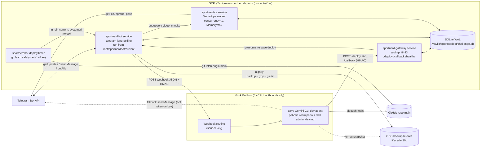
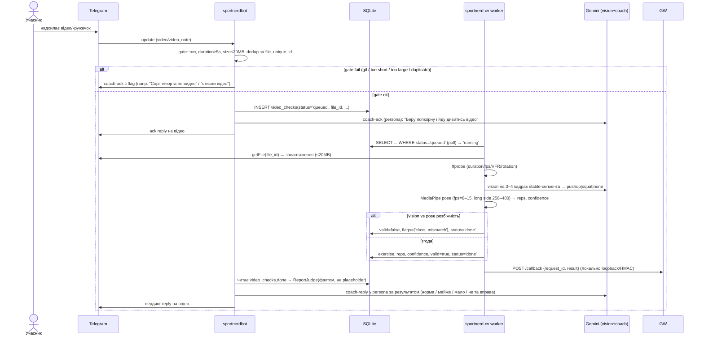

# SportNerdBot — Target Architecture

> Статус: цільова (to-be) архітектура. Базується на репо станом на 2026-10-20 (long-polling aiogram,
> SQLite, Gemini flash-lite, e2-micro) та на `PLANNING_BRIEF.md`. Усі рішення по open questions —
> у розділі 9.

## 1. Принципи й межі

- **Один polling-процес** лишається джерелом правди для Telegram-трафіку (constraint C3: другий
  `getUpdates` на той самий токен → 409 Conflict). Жодного справжнього blue/green.
- **Деплой pull-based** (C4: outbound SSH з машини користувача заблоковано): VM сама тягне з GitHub.
- **Важкі/рідкісні задачі офлоадяться** на Grok Bot box через webhook routine (C5): video-аналіз
  довгих відео та code/prompt/schema зміни (`admin_dev`). Дрібні data-tweaks лишаються in-bot заради
  швидкості (USER INTENTION 1A.1, варіант A).
- **Git — єдине джерело правди** для коду, схеми та prompt-дефолтів. Будь-яка persistent-зміна
  проходить через commit у `main`.
- **Secrets не передаються в runtime routine** (C6): токени заздалегідь лежать на box
  (`/workspace/pipbot/.env`, gitignored) і на VM (`/etc/sportnerdbot/env`, `0600`).

## 2. Компонентна діаграма



Легенда потоків:
- **Chat:** Telegram ⇄ `sportnerdbot.service` (єдиний polling).
- **Video (локальний шлях):** bot кладе задачу в `video_checks` → `sportnerd-cv.service` обробляє →
  пише результат у БД → bot (через callback у БД або gateway) публікує вердикт.
- **Video (offload шлях):** bot → routine webhook → box рахує → `POST /callback` на gateway → judge.
- **admin_dev:** bot → routine webhook → box змінює код/prompts/migrations → `git push main` →
  `POST /deploy` на gateway (або safety-net timer) → release-switch → bot публікує `reply_text` із
  `pending_replies`.

## 3. Sequence diagram 1 — Video report (async)



## 4. Sequence diagram 2 — admin_dev request → push → deploy → reply

```mermaid
sequenceDiagram
  actor A as Адмін (passphrase)
  participant TG as Telegram
  participant BOT as sportnerdbot
  participant DB as SQLite
  participant RT as Grok routine
  participant AG as box dev agent
  participant GH as GitHub main
  participant GW as sportnerd-gateway
  participant NEW as bot (нова версія)

  A->>TG: admin-фраза (напр. reply на повідомлення) з кодовою фразою
  TG->>BOT: update
  BOT->>BOT: Router → admin_dev (passphrase guard) 
  BOT->>DB: INSERT offload_requests(status='sent'), admin_audit(request)
  BOT->>TG: ack "Прийняв, виконую. request_id=…" (reply на оригінал)
  BOT->>RT: POST webhook {request_id, referenced_text, recent_messages, author, HMAC}
  RT->>AG: wake
  AG->>AG: формалізує → план за категоріями (DB data / нові entities / код / prompts)
  AG->>AG: редагує робочу копію, пише migration, pytest offline
  alt tests pass & зони дозволені
    AG->>GH: git push main (commit містить request_id)
    AG->>GW: POST /deploy {request_id, sha, reply_text, chat_id, reply_to_message_id, HMAC}
    GW->>GW: git fetch; checkout releases/<sha>; migrations(+backup); smoke
    GW->>DB: INSERT pending_replies(request_id, chat_id, reply_to, reply_text, status='pending')
    GW->>GW: ln -sfn current→releases/<sha>; systemctl restart; health
    GW-->>AG: 202 Accepted (фінальний статус — GET /deploy/<request_id>)
    Note over BOT,NEW: під час restart polling паде на кілька секунд
    NEW->>DB: startup: читає pending_replies (status='pending')
    NEW->>TG: публікує reply_text (admin-стиль) як reply на оригінал
    NEW->>DB: pending_replies→'sent'; offload_requests→'done'; admin_audit(commit_sha,status=ok)
  else tests fail / заборонена зона
    AG->>GW: POST /callback {request_id, status='failed', reason}
    GW->>DB: offload_requests→'failed'
    BOT->>TG: пояснення адміну; (обмежено ≤2 авто-спроби виправлення)
  end
```

## 5. Sequence diagram 3 — Deploy з rollback (release-dir + atomic symlink)

```mermaid
sequenceDiagram
  participant TRIG as Trigger (/deploy endpoint АБО deploy.timer)
  participant DEP as deploy.sh (release script)
  participant GH as GitHub
  participant MIG as migration runner
  participant DB as SQLite
  participant SYS as systemd

  TRIG->>DEP: deploy(sha | origin/main HEAD)
  DEP->>GH: git fetch --all
  DEP->>DEP: git worktree/checkout → releases/<sha>
  DEP->>DEP: pip install якщо hash(requirements.txt) змінився (інакше спільний venv)
  DEP->>DB: sqlite3 .backup → /var/lib/sportnerdbot/backups/<ts>.db
  DEP->>MIG: apply migrations до HEAD (expand-only, idempotent)
  alt migration fail
    MIG-->>DEP: error
    DEP->>DEP: лишаємо старий symlink; статус=failed
  else migration ok
    DEP->>DEP: smoke: python -c "import bot; bot.build_app()" + pytest -m offline
    alt smoke fail
      DEP->>DEP: статус=failed, symlink не чіпаємо
    else smoke ok
      DEP->>DEP: PREV=$(readlink current); ln -sfn releases/<sha> current
      DEP->>SYS: systemctl restart sportnerdbot
      DEP->>SYS: health: active N сек + лог "polling started" / GET /healthz
      alt health fail
        DEP->>DEP: ln -sfn $PREV current; systemctl restart; status=rolled_back
      else health ok
        DEP->>DEP: prune: лишити останні 5 releases/, status=ok
      end
    end
  end
```

## 6. Розміщення на VM, systemd, users, secrets

### 6.1 Файлова структура
```
/opt/sportnerdbot/
  releases/<git_sha>/        # чистий checkout одного релізу (код + prompts.py + migrations/)
  current -> releases/<sha>  # атомарний symlink; ExecStart іде сюди
  venv/                      # спільний venv (перестворюється лише при зміні requirements hash)
  shared/                    # незмінне між релізами (логи-симлінки за потреби)
/etc/sportnerdbot/env        # EnvironmentFile, 0600, owner sportnerd (BOT_TOKEN, CHAT_ID, GEMINI_API_KEY, GATEWAY_HMAC, DB_PATH)
/var/lib/sportnerdbot/
  challenge.db               # WAL; поза release dir
  challenge.db-wal / -shm
  backups/<ts>.db            # pre-migration + nightly
  pending/                   # опційний файловий fallback для pending_replies
/usr/local/bin/sportnerd-deploy.sh   # release script (у git: deploy/deploy.sh)
```

### 6.2 systemd units
| Unit | Призначення | Ключові директиви |
|---|---|---|
| `sportnerdbot.service` | polling-бот | `User=sportnerd`, `WorkingDirectory=/opt/sportnerdbot/current`, `EnvironmentFile=/etc/sportnerdbot/env`, `Restart=always`, `NoNewPrivileges=yes`, `ProtectSystem=strict`, `ReadWritePaths=/var/lib/sportnerdbot /opt/sportnerdbot`, `MemoryMax=550M` |
| `sportnerd-cv.service` | CV worker (черга з `video_checks`) | `User=sportnerd`, `Nice=10`, `MemoryMax=500M`, `CPUWeight=50`, concurrency=1 |
| `sportnerd-gateway.service` | aiohttp `/deploy /callback /healthz` | `User=sportnerd`, `MemoryMax=80M`, слухає loopback+`:8443` за firewall |
| `sportnerdbot-deploy.timer` + `.service` | safety-net pull (1–2 хв) | `User=sportnerd`, oneshot `sportnerd-deploy.sh` |

### 6.3 Users / permissions
- Створити **non-root** `sportnerd` (бувший `User=root` → прибрати, bug #7).
- Власник `/var/lib/sportnerdbot`, `/opt/sportnerdbot`, `/etc/sportnerdbot/env` = `sportnerd`.
- `git push` робить **box**, не VM. VM лише `fetch` (deploy key read-only або публічний репо).

### 6.4 Secrets
- VM: `/etc/sportnerdbot/env` (0600) — `BOT_TOKEN`, `CHAT_ID`, `GEMINI_API_KEY`, `GATEWAY_HMAC_SECRET`,
  `GCS_BUCKET`, `DB_PATH=/var/lib/sportnerdbot/challenge.db`.
- Box: `/workspace/pipbot/.env` (gitignored) — `BOT_TOKEN` (для fallback sendMessage), `GITHUB_TOKEN`/deploy key,
  `GATEWAY_HMAC_SECRET` (той самий), `ROUTINE_SHARED_SECRET`.
- `GATEWAY_HMAC_SECRET` і `ROUTINE_SHARED_SECRET` — однакові на обох сторонах, у git **не зберігаються**.

## 7. Схема БД та стратегія міграцій

### 7.1 Наявні таблиці (as-is, не ламати)
`progress` (legacy: `lyosha_done`/`sasha_done`), `users`, `user_progress`, `chat_history`,
`bot_state`, `prompts`, `prompt_history`. Схема зараз створюється через `CREATE TABLE IF NOT EXISTS`
у `Store.init_schema` — версіонованих міграцій немає.

### 7.2 Нові таблиці
```sql
-- трекер застосованих міграцій
CREATE TABLE IF NOT EXISTS schema_version (
  version    INTEGER PRIMARY KEY,
  name       TEXT NOT NULL,
  applied_at TIMESTAMP DEFAULT CURRENT_TIMESTAMP
);

-- результати video-аналізу (контракт у 8.3)
CREATE TABLE IF NOT EXISTS video_checks (
  id              INTEGER PRIMARY KEY AUTOINCREMENT,
  request_id      TEXT UNIQUE,
  chat_id         INTEGER NOT NULL,
  message_id      INTEGER NOT NULL,
  user_slug       TEXT,
  file_id         TEXT,
  file_unique_id  TEXT,
  duration_s      REAL,
  exercise        TEXT,            -- 'pushup'|'squat'|'none'
  reps            INTEGER,
  confidence      REAL,
  flags           TEXT,            -- JSON array
  valid           INTEGER DEFAULT 0,
  status          TEXT NOT NULL DEFAULT 'queued',  -- queued|running|done|failed
  analyzer_version TEXT,
  location        TEXT,            -- 'vm'|'box'
  created_at      TIMESTAMP DEFAULT CURRENT_TIMESTAMP,
  finished_at     TIMESTAMP
);
CREATE INDEX IF NOT EXISTS idx_video_checks_status ON video_checks(status);

-- офлоад-запити на box (admin_dev та/або video)
CREATE TABLE IF NOT EXISTS offload_requests (
  request_id      TEXT PRIMARY KEY,
  type            TEXT NOT NULL,   -- 'admin'|'video'
  chat_id         INTEGER,
  message_id      INTEGER,
  reply_to_message_id INTEGER,
  author_slug     TEXT,
  payload         TEXT,            -- JSON (directive, referenced_text, recent_messages)
  status          TEXT NOT NULL DEFAULT 'sent',  -- sent|acked|done|failed|expired
  commit_sha      TEXT,
  attempts        INTEGER DEFAULT 0,
  expires_at      TIMESTAMP,
  created_at      TIMESTAMP DEFAULT CURRENT_TIMESTAMP,
  updated_at      TIMESTAMP DEFAULT CURRENT_TIMESTAMP
);

-- відповіді, які мають пережити restart (ідемпотентно за request_id)
CREATE TABLE IF NOT EXISTS pending_replies (
  request_id          TEXT PRIMARY KEY,
  chat_id             INTEGER NOT NULL,
  reply_to_message_id INTEGER,
  text                TEXT NOT NULL,
  status              TEXT NOT NULL DEFAULT 'pending', -- pending|sent
  attempts            INTEGER DEFAULT 0,
  created_at          TIMESTAMP DEFAULT CURRENT_TIMESTAMP
);

-- аудит admin_dev
CREATE TABLE IF NOT EXISTS admin_audit (
  id          INTEGER PRIMARY KEY AUTOINCREMENT,
  request_id  TEXT,
  author_slug TEXT,
  request     TEXT,
  plan        TEXT,
  commit_sha  TEXT,
  status      TEXT,            -- planned|pushed|deployed|failed|rejected
  created_at  TIMESTAMP DEFAULT CURRENT_TIMESTAMP
);
```

### 7.3 Стратегія міграцій
- Каталог `migrations/NNNN_name.sql|py` у git. Runner `database/migrate.py`:
  читає `schema_version`, застосовує лише нові `NNNN` у транзакції, пише рядок у `schema_version`.
- **Ідемпотентно**, запускається **до** switch symlink. Перед застосуванням — `sqlite3 .backup`
  (online backup API) у `/var/lib/sportnerdbot/backups/`.
- Лише **expand-only** (add column/table), щоб rollback коду не ламав БД. Destructive (drop legacy
  `progress`, cleanup) — окремою міграцією **після стабілізації**, з окремим підтвердженням.
- Ад-хок `migrate_prompts.py`, `migrate_users.py`, `enable_alternating.py` → перетворити на
  пронумеровані міграції (seed-логіка `seed_prompts` лишається idempotent) і **прибрати з деплою як
  безумовні кроки**. `Store.init_schema` лишається для `CREATE IF NOT EXISTS` bootstrap, але істина —
  у `migrations/`.
- `PRAGMA journal_mode=WAL`, `busy_timeout=5000`, `foreign_keys=ON` у `Store._connect`.

## 8. JSON-контракти (версіоновані)

Усі payload містять `"contract_version": "1.0"`. Зміна формату → bump + підтримка попередньої версії
на приймаючій стороні ≥1 реліз.

### 8.1 Request: bot → routine webhook
```json
{
  "contract_version": "1.0",
  "request_id": "uuid-v4",
  "type": "admin|video",
  "created_at": "2026-10-20T20:47:00+03:00",
  "chat_id": -100123,
  "message_id": 4567,
  "reply_to_message_id": 4560,
  "user": {"telegram_id": 111, "username": "x", "slug": "sasha"},
  "payload": {"text": "...", "referenced_text": "...", "recent_messages": ["..."]},
  "file_id": "BAAC...", "file_unique_id": "AgAD...",
  "reply_mode": "telegram_direct|callback|both",
  "ts": 1760982420,
  "signature": "hmac-sha256(hex, body || ts, ROUTINE_SHARED_SECRET)"
}
```

### 8.2 Callback / Result: box → gateway `/callback`
```json
{
  "contract_version": "1.0",
  "request_id": "uuid-v4",
  "status": "done|failed",
  "result": { "...": "video result (8.3) або admin summary" },
  "commit_sha": "abc123",
  "reply_text": "coach-persona текст для чату",
  "ts": 1760982500,
  "signature": "hmac-sha256(hex, body || ts, GATEWAY_HMAC_SECRET)"
}
```

### 8.3 Video analyze result (`analyze_video`)
```json
{
  "contract_version": "1.0",
  "request_id": "uuid", "file_unique_id": "AgAD...", "duration_s": 75.2,
  "exercise": "squat|pushup|none", "reps": 50, "confidence": 0.87,
  "vision_class": "squat", "pose_class": "squat",
  "flags": ["short","gif","duplicate","class_mismatch","low_body_visibility","too_large","vfr"],
  "valid": true, "analyzer_version": "cv-1.0", "elapsed_s": 31.4
}
```

### 8.4 Deploy: box → gateway `/deploy`
```json
{
  "contract_version": "1.0",
  "request_id": "uuid",
  "sha": "abc123",
  "chat_id": -100123, "reply_to_message_id": 4560,
  "reply_text": "coach-persona admin reply",
  "ts": 1760982600,
  "signature": "hmac-sha256(hex, body || ts, GATEWAY_HMAC_SECRET)"
}
```
Відповідь: `202 Accepted` одразу; фінальний статус — `GET /deploy/<request_id>` →
`{"status":"ok|rolled_back|failed","sha":"...","detail":"..."}`.

### 8.5 Auth / idempotency (спільне)
- HMAC-SHA256 над `body || ts`; `ts` у вікні ±5 хв; replay поза вікном → `401`.
- Для routine: sender key (із панелі) **плюс** власний HMAC (захист, якщо URL витече).
- Idempotency-ключ усюди — `request_id`: повторна доставка → no-op (повертаємо збережений статус).

## 9. Рішення по open questions

| QID | Рішення | Обґрунтування |
|---|---|---|
| Q1.1 downtime/drain | **Приймаємо 10–30 s downtime**; м'який drain: deploy чекає завершення поточного `ChatFlow.process` (`_lock`) до 20 s, тоді restart. | Telegram тримає апдейти до 24 год; повідомлення не губляться. Drain уникає обриву середини verdict. |
| Q1.2 timer vs runner | **Timer (safety-net) + `/deploy` endpoint (основний)**. Self-hosted runner відкинуто. | Runner їсть 100–200 MB RAM — критично на 1 GB. Endpoint дає секунди; timer гарантує сходження до `main`. |
| Q1.3 що деплоїмо | Деплоїмо **кожен push у `main`, що проходить smoke+offline pytest на VM**. CI-гейт — цей локальний smoke; додатково пропускаємо коміти з маркером `[wip]` у subject. | Один розробник + box agent, окремий CI-gate через GitHub API ускладнює; локальний smoke достатній. |
| Q2.1 GCS bucket | **Потрібне рішення користувача** (default: створити bucket free-tier 5 GB, lifecycle 30 днів). Позначено `[MANUAL]`. | Вимагає доступу до GCP-консолі/IAM. |
| Q2.2 legacy `progress` | **Залишити read-only**, дані мігрувати у `user_progress`; drop — окремою destructive-міграцією пізніше. | Expand-only політика; безпечний rollback. |
| Q2.3 box ↔ prod DB | **Без прямого доступу**: box аналізує GCS-snapshot, зміни даних — як data-migration у коміті (варіант a). | Уникаємо write-конфліктів у SQLite з двох машин; усе в git/audit. |
| Q3.1 push conflict | Див. Q1 (ключове) нижче. | — |
| Q3.2 agy vs Gemini CLI | **Потрібне підтвердження, що саме встановлено/авторизовано на box без інтерактиву** (default: `agy` headless, бо він — цільовий виконавець). `[MANUAL]` перевірка. | Не можемо перевірити env box із репо. |
| Q3.3 власник commit | **Deploy key / PAT з мінімальним scope `repo` на один репозиторій** на box. `[MANUAL]`. | Push робить лише box; VM — read-only fetch. |
| Q3.4 tests fail | **Відповісти адміну з поясненням + ≤2 авто-спроби виправлення**, далі стоп і статус `failed`. | Баланс автономності й безпеки; без нескінченних циклів квоти. |
| Q4.1 строгість | `done` вимагає `reps ≥ target` **і** `confidence ≥ 0.6`; near-miss → coach просить докинути (persona); low confidence → просить перезаписати, **не** автозараховує. Partial не зараховується автоматично. | Anti-cheat + уникнення хибних зарахувань на шумному pose. |
| Q4.2 video notes | **Gate+dedup+duration з v1 для всіх типів**; front-camera **pushup counting** — у фазі 3 (вертикальний рух плечей+носа). До фіксу front-camera pushup позначається flag і просить бокову зйомку. | Front-camera за кутом ліктя не рахується (foreshortening, лікті не видно). |
| Q4.3 зберігати відео | **Ні, лише метадані** (`video_checks`). | Приватність + диск e2-micro. |
| Q4.4 swap | **Додати 1–2 GB swap** на e2-micro. `[MANUAL]`. | Peak RAM CV ~380 MB поряд із ботом на 1 GB → ризик OOM. |
| Q5.1 HTTPS-порт | **Потрібне рішення користувача** (default: `sportnerd-gateway` на `:8443`, Caddy або self-signed + HMAC, firewall-allowlist). `[MANUAL]`. | Video-результат має дійти до judge → потрібен inbound callback; endpoint також служить `/deploy`. |
| Q5.2 quota wake | **Потрібне рішення користувача** (default: offload на box лише довгі/native-fps відео й усі `admin_dev`; короткі відео — локально на VM). | Кожен wake їсть квоту Grok Bot. |
| Q5.3 MCP server | **Пізніше, не зараз.** | Для GCP→box непотрібний; box уже має робочу копію репо. |
| Q2 (prompts істина) | **Git-міграції — джерело правди.** Persistent prompt-зміни йдуть через box→commit. `agents/prompt_editor.py` лишається **лише offline-fallback**, коли box недоступний (пише в БД з `updated_by='bot_fallback'`, позначається для reconcile). `seed_prompts` чіпає лише `updated_by='seed'`. | Уникнення розходження БД↔git; USER INTENTION 1A.1 (prompts на box). |
| Q3 (webhook?) | **Лишаємось на polling зараз**; webhook — задокументований майбутній шлях (відкриває blue/green + native callback). | Міграція поза скоупом цього плану. |

### 9.1 ⭐ Q1 — ключовий confirm-point (push у main)
**Рішення (гібрид b+c):** для `admin_dev` box **пушить напряму в `main`** (USER INTENTION 1A.4), але:
- **Дозволено без підтвердження:** DB data changes (через data-migration), prompt-зміни (через
  prompt-migration), serving-код агентів, нові DB entities — за умови **green offline pytest** та що
  зміни **не торкаються заборонених зон**.
- **Заборонені зони → вимагають `/approve <request_id>` від того самого адміна в Telegram** (c-style
  gate): `.env`/secrets, `deploy/*` скрипти, systemd-units, GitHub workflow-файли, destructive-міграції
  (DROP/DELETE історичних даних, зміна lives/progress заднім числом). Для них box готує гілку
  `auto/<request_id>`, бот показує план, деплой — лише після `/approve`.
- **Загальна (не-admin) розробка** зберігає правило «план → локальні тести → push після OK».

## 10. Ризики та mitigations

| Ризик | Вплив | Mitigation |
|---|---|---|
| OOM на e2-micro (CV + bot + gateway) | краш бота | `MemoryMax=` на кожен unit; swap 1–2 GB; CV concurrency=1, `Nice`; короткі відео локально, довгі → box |
| CPU starvation під час CV | затримка чату | `CPUWeight` боту вище; черга `video_checks`; async (bug #9) — CV поза global `_lock` бота |
| Gemini free-tier quota (C1) | 429/недоступність | ring-buffer limiter вже є; vision лише 3–4 кадри; `admin_dev` офлоадиться (не їсть чат-квоту); детерміновані fallback-и збережені |
| 409 Conflict (два polling) | бот не отримує апдейти | один `sportnerdbot.service`; під час restart старий процес убитий до старту нового; `delete_webhook` на старті вже є |
| Втрата `reply_text` при restart | користувач без відповіді | `pending_replies` у БД, нова версія досилає ідемпотентно за `request_id` |
| Відкритий `:8443` endpoint | поверхня атаки | HMAC + timestamp window + firewall allowlist + TLS; endpoint дуже легкий; timer як незалежний safety-net |
| Telegram `getFile` > 20 MB (C7) | аналіз неможливий | gate: `too_large` flag → прохання стиснути/обрізати |
| Message-loss у ту ж секунду (bug #1) | звіт не враховано | курсор за `(created_at, chat_history.id)` замість секундного ts |
| anti-cheat GIF (bug #4) | фальшиве зарахування | до CV — GIF/animation не автозараховуються; після — gate reject |
| Розходження prompts БД↔git | неузгоджена поведінка | git-міграції = істина; runtime-edit лише fallback із reconcile-флагом |
| Rollback коду при новій схемі | краш старого коду | expand-only міграції; backup перед кожною |
| Box недоступний / routine quota | admin/video не виконано | timeout N хв → бот повідомляє user, статус `failed`/`expired`; короткі відео мають локальний шлях |

