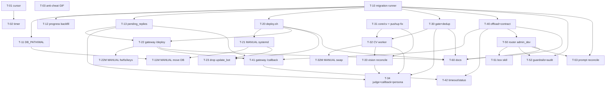

# SportNerdBot — Work Plan для автономного агента (Gemini 3.8 / `agy` у Antigravity)

> Кожна задача **самодостатня**: агент не бачить brief чи чату. Контекст вшито в `Goal`.
> Проєкт: Telegram-бот (Python, aiogram long-polling) на GCP e2-micro; SQLite `challenge.db`;
> Gemini через `core/llm.py`; агенти в `agents/`; оркестратор `app/flow.py`; сховище `database/store.py`;
> бізнес-логіка челенджу `core/challenge.py`; дефолтні prompts `prompts.py`.
> **Глобальні guardrails для КОЖНОЇ задачі (якщо не зазначено інше):** НЕ робити `git push`, НЕ деплоїти,
> НЕ чіпати `.env`/secrets, НЕ торкатися prod-БД на сервері, НЕ видаляти дані без явної destructive-міграції.
> Працювати в гілці, лишати зміни в working tree для рев'ю. Тести — локально, без мережі
> (`pytest -p no:cacheprovider` або маркер offline; мокати Gemini через фейковий LLM/Sender як у
> `tests/flow_fixtures.py`, `tests/conftest.py`).

---

## Фаза 0 — Bugfixes + тести

### T-01: Курсор необроблених повідомлень за (created_at, id)
- **Goal:** Зараз `Store.unprocessed_user_messages` і `last_processed_timestamp` працюють із точністю до
  секунди (`%Y-%m-%d %H:%M:%S`). Два повідомлення в ту саму секунду можуть загубитися, бо курсор
  рухається лише за `created_at`. Треба зробити курсор монотонним за `(created_at, chat_history.id)`,
  щоб жоден звіт не випав.
- **Files:** змінити `database/store.py` (`unprocessed_user_messages`, можливо новий `get_state`-ключ),
  `app/flow.py` (`ChatFlow.process` — збереження курсора). Не чіпати схему `chat_history` (id уже є).
- **Steps:**
  1. Зберігати курсор як пару: або окремий ключ `last_processed_id` у `bot_state`, або складений
     `last_processed_timestamp` + `last_processed_id`.
  2. У `unprocessed_user_messages` додати умову `(created_at > ? OR (created_at = ? AND id > ?))`
     замість лише `created_at > ?`; лишити фільтр `created_at >= day_start_ts`.
  3. У `ChatFlow.process` після обробки `pending` зберігати `created_at` **та** `id` останнього.
- **Acceptance criteria:** два user-повідомлення з однаковим `created_at` обидва потрапляють в обробку
  рівно один раз; повторний `process` не повертає вже оброблені.
- **Tests:** додати офлайн-тест у `tests/test_flow_offline.py`: вставити 2 повідомлення з однаковою
  секундою, викликати `process` двічі, перевірити що оброблені один раз. `pytest tests/test_flow_offline.py`.
- **Dependencies:** —
- **Phase:** 0
- **Out of scope / guardrails:** без зміни формату `created_at`; без push.

### T-02: Таймер-нагадування не має губитися через pending
- **Goal:** У `ChatFlow.process` при `trigger="timer"` нагадування (`_handle_timer`) виконується лише
  якщо немає pending-повідомлень (`elif trigger == "timer"`). Якщо прийшли pending, заплановане
  нагадування (morning/afternoon/evening/night/settle) мовчки пропускається. Треба спершу обробити
  pending, а потім усе одно відпрацювати timer-job.
- **Files:** `app/flow.py` (`process`, `_handle_timer`).
- **Steps:**
  1. Для `trigger="timer"`: спочатку обробити pending (якщо є), потім **завжди** викликати
     `_handle_timer` для відповідного `job`.
  2. Переконатися, що `settle` (00:05) не блокується наявністю pending.
  3. Уникнути подвійного `set_state("last_processed_timestamp")`, що ламає курсор (узгодити з T-01).
- **Acceptance criteria:** за наявності pending і timer-job одночасно виконуються обидва шляхи;
  `settle` завжди відпрацьовує.
- **Tests:** офлайн-тест: pending + `trigger="timer", job="morning"` → і verdict/coach, і ранкове
  нагадування (або узгоджена поведінка) спрацьовують. `pytest tests/test_flow_offline.py`.
- **Dependencies:** T-01
- **Phase:** 0
- **Out of scope / guardrails:** без push.

### T-03: Anti-cheat interim — не зараховувати GIF/animation автоматично
- **Goal:** Зараз `bot.py::describe_message` для `video`/`video_note`/`animation` підставляє placeholder
  «[Надіслано відеозвіт виконання норми]», і `ReportJudgeAgent` може зарахувати навіть GIF/мем як
  виконання (anti-cheat hole). До впровадження CV (фаза 3) треба, щоб `animation` (GIF) **не** давав
  автозарахування, а справжні `video`/`video_note` поки лишались як є (placeholder), але позначались.
- **Files:** `bot.py` (`describe_message`), за потреби `agents/report_judge.py` (підказка в prompt або
  детермінований фільтр). Не змінювати схему.
- **Steps:**
  1. Для `message.animation` (GIF) формувати текст, що явно НЕ є доказом виконання (напр.
     «[Надіслано GIF/анімацію — не є відеозвітом]»).
  2. Переконатися, що judge на такий текст не ставить `done=true` (додати правило у heuristic fallback
     `ReportJudgeAgent.fallback` і/або у prompt-інструкцію).
- **Acceptance criteria:** GIF/animation не призводить до `set_done(..., True)`; звичайний відеозвіт
  поведінку не змінює.
- **Tests:** офлайн-тест judge: вхід із GIF-плейсхолдером → `done=false`. Запустити релевантний
  `tests/integration/test_agents.py` offline-підмножину.
- **Dependencies:** —
- **Phase:** 0
- **Out of scope / guardrails:** не прибирати placeholder для `video` (це робить фаза 3); без push.

---

## Фаза 1 — DB relocation + versioned migrations

### T-10: Versioned migration runner + schema_version + backup
- **Goal:** Схема зараз створюється через `CREATE TABLE IF NOT EXISTS` у `Store.init_schema`, а ад-хок
  скрипти (`migrate_prompts.py`, `migrate_users.py`, `enable_alternating.py`) ганяються при кожному
  деплої. Потрібен ідемпотентний versioned-migration runner: каталог `migrations/NNNN_name.sql|py`,
  таблиця `schema_version`, backup БД перед застосуванням.
- **Files:** створити `migrations/` (з `0001_init.sql`, що віддзеркалює поточну схему як baseline),
  `database/migrate.py` (runner). Змінити `database/store.py` лише щоб `init_schema` лишався bootstrap,
  не конфліктував. Не видаляти наявні таблиці.
- **Steps:**
  1. `schema_version(version, name, applied_at)`.
  2. Runner: знайти застосовані версії, застосувати нові по порядку в одній транзакції на файл, записати
     рядок у `schema_version`. Підтримати `.sql` і `.py` (з функцією `upgrade(conn)`).
  3. Перед будь-яким застосуванням — `sqlite3` online `.backup` у `backups/<ts>.db` (шлях із конфіга).
  4. CLI: `python -m database.migrate --db <path>` → застосовує до HEAD; `--status` показує поточну версію.
  5. `0001_init.sql` = baseline (усі наявні `CREATE TABLE IF NOT EXISTS`), версія 1 вважається
     застосованою на існуючих БД (detect: якщо `users` існує і `schema_version` порожня → stamp v1).
- **Acceptance criteria:** на чистій БД runner створює всі таблиці й ставить version=1; повторний запуск
  — no-op; на існуючій legacy-БД — stamp без втрати даних; backup-файл створюється.
- **Tests:** `tests/test_migrations.py` (offline, tmp sqlite): чистий old→new, ідемпотентність, stamp
  legacy. `pytest tests/test_migrations.py`.
- **Dependencies:** —
- **Phase:** 1
- **Out of scope / guardrails:** лише expand-only; жодних DROP; без push.

### T-11: Конфіг DB_PATH поза release dir + WAL/pragmas
- **Goal:** Зараз `challenge.db` живе в каталозі коду (`/opt/sportnerdbot/challenge.db`) і бекапиться
  разом із кодом. БД має жити окремо (`/var/lib/sportnerdbot/challenge.db`), з `WAL`, `busy_timeout`,
  `foreign_keys`. `DB_PATH` уже читається з env у `core/config.py`.
- **Files:** `database/store.py` (`_connect` — додати PRAGMA), `core/config.py` (дефолт лишити
  BASE_DIR для локалки, але документувати env-override). Не хардкодити абсолютний VM-шлях у код.
- **Steps:**
  1. У `Store._connect` виконати `PRAGMA journal_mode=WAL; PRAGMA busy_timeout=5000; PRAGMA foreign_keys=ON;`.
  2. Переконатися, що тести (tmp-path БД) не ламаються від WAL.
- **Acceptance criteria:** з'єднання відкривається з WAL; наявні тести зелені; локальний дефолт-шлях
  не змінився.
- **Tests:** `pytest tests/` (offline-підмножина) зелена; доданий тест перевіряє PRAGMA.
- **Dependencies:** —
- **Phase:** 1
- **Out of scope / guardrails:** фізичне переміщення файлу на VM — **[MANUAL]** (див. T-11M); без push.

### T-11M [MANUAL]: Перенести БД на VM у /var/lib
- **Goal:** Фізично перемістити prod-БД у `/var/lib/sportnerdbot/challenge.db`, виставити owner
  `sportnerd`, прописати `DB_PATH` у `/etc/sportnerdbot/env`. Це дія на сервері — агент НЕ виконує.
- **Інструкція для людини:** `systemctl stop sportnerdbot` → `mkdir -p /var/lib/sportnerdbot` →
  `mv /opt/sportnerdbot/challenge.db* /var/lib/sportnerdbot/` → `chown -R sportnerd:sportnerd
  /var/lib/sportnerdbot` → додати `DB_PATH=/var/lib/sportnerdbot/challenge.db` у env → старт після фази 2.
- **Dependencies:** T-11, T-21
- **Phase:** 1
- **Out of scope / guardrails:** агент не має доступу до VM.

### T-12: Data-migration legacy progress → user_progress + прибрати хардкод lyosha/sasha
- **Goal:** `Store.set_done/get_user_done/get_day_progress` і `core/challenge.py`
  (`SASHA_ALIASES`/`LYOSHA_ALIASES`) хардкодять `lyosha`/`sasha` та legacy-таблицю `progress`. Треба
  мігрувати історичні дані з `progress` у `user_progress` і прибрати хардкод, лишивши `progress`
  read-only (expand-only, без DROP).
- **Files:** нова міграція `migrations/0002_backfill_progress.py`; `database/store.py` (прибрати запис у
  `progress`, лишити читання як fallback лише для вже наявних рядків); `core/challenge.py` (прибрати
  hardcoded aliases, спиратись на `users.aliases`).
- **Steps:**
  1. Міграція: для кожного рядка `progress(date, lyosha_done, sasha_done)` зробити upsert у
     `user_progress` для slug `lyosha`/`sasha` (якщо такі users існують).
  2. `set_done` більше не пише в `progress` (тільки `user_progress`).
  3. Прибрати `SASHA_ALIASES`/`LYOSHA_ALIASES`; aliases брати з `users`.
- **Acceptance criteria:** після міграції `get_day_progress` для історичних дат збігається зі старими
  значеннями; нові зарахування йдуть лише в `user_progress`; `progress` не отримує нових записів.
- **Tests:** `tests/test_migrations.py` розширити: seed legacy `progress`, прогнати міграцію, звірити
  `get_day_progress`. Офлайн.
- **Dependencies:** T-10
- **Phase:** 1
- **Out of scope / guardrails:** НЕ робити DROP `progress` (окрема destructive-міграція пізніше, за
  `/approve`); без push.

### T-13: Таблиця pending_replies + drain на startup
- **Goal:** Під час деплою/restart polling-процес гине; відповідь, яку треба надіслати після деплою
  (`reply_text`), має пережити restart. Потрібна таблиця `pending_replies` і механізм: на startup бот
  читає `status='pending'` і надсилає (ідемпотентно за `request_id`), потім ставить `sent`.
- **Files:** міграція `migrations/0003_pending_replies.sql`; `database/store.py` (методи
  `add_pending_reply`, `list_pending_replies`, `mark_reply_sent`); `bot.py`/`app/flow.py`
  (startup-drain у `main()` перед polling або у `flow.init_storage`).
- **Steps:**
  1. Схема `pending_replies` (див. ARCHITECTURE 7.2).
  2. На startup: для кожного pending → `sender.send_text`/reply, при успіху `mark_reply_sent`,
     `attempts++` при фейлі; ліміт спроб.
  3. Ідемпотентність за `request_id` (PK).
- **Acceptance criteria:** після імітованого restart pending-reply надсилається рівно раз; повторний
  старт не дублює.
- **Tests:** офлайн-тест із фейковим Sender: додати pending, викликати drain двічі → один send.
- **Dependencies:** T-10
- **Phase:** 1
- **Out of scope / guardrails:** без push.

---

## Фаза 2 — Pull-based deploy + rollback

### T-20: Release-dir deploy script (fetch→checkout→migrate→smoke→switch→health→rollback)
- **Goal:** Зараз деплой — розпаковка tar поверх робочого каталогу (`deploy.ps1`), БД поряд із кодом,
  ад-хок скрипти щоразу. Потрібен серверний bash-скрипт, який робить деплой через release-каталоги й
  атомарний symlink: `releases/<sha>` + `current -> releases/<sha>`, з backup, міграціями, smoke-тестом
  і automatic rollback.
- **Files:** створити `deploy/deploy.sh` (у git), `deploy/README.md`. Не чіпати runtime-код бота.
- **Steps:**
  1. Аргумент: `sha` (або `origin/main`). `git fetch --all`; checkout у `releases/<sha>`.
  2. venv: якщо `sha256(requirements.txt)` змінився відносно кешу — `pip install`, інакше спільний venv.
  3. `sqlite3 .backup` БД у `backups/<ts>.db`.
  4. `python -m database.migrate --db $DB_PATH` (до HEAD).
  5. Smoke: `python -c "import bot; bot.build_app()"` + `pytest -m offline` (швидка підмножина).
  6. `PREV=$(readlink current)`; `ln -sfn releases/<sha> current`; `systemctl restart sportnerdbot`.
  7. Health: процес active ≥N сек + grep "polling started" у journal / `GET /healthz`.
  8. Fail на кроках 4–7 → `ln -sfn $PREV current; systemctl restart`; вихідний код ≠0; статус-файл.
  9. Prune: лишити останні 5 `releases/`.
- **Acceptance criteria:** скрипт shellcheck-чистий; у dry-run/локальному режимі (env `DRY_RUN=1`) логіка
  checkout/symlink/rollback відпрацьовує без реального systemd.
- **Tests:** `bats` або shell-тест із `DRY_RUN=1` у фейковому git-репо: успішний деплой + симульований
  rollback. `shellcheck deploy/deploy.sh`.
- **Dependencies:** T-10
- **Phase:** 2
- **Out of scope / guardrails:** скрипт лише у working tree; реальний запуск на VM — людина; без push.

### T-21 [MANUAL]: systemd units, non-root user, hardening
- **Goal:** Сервіс зараз під `User=root`. Потрібен non-root `sportnerd`, hardening і EnvironmentFile.
  Агент готує шаблони unit-файлів у git; встановлення на VM — людина.
- **Files:** створити `deploy/systemd/sportnerdbot.service`, `sportnerd-gateway.service`,
  `sportnerd-cv.service`, `sportnerdbot-deploy.service`, `sportnerdbot-deploy.timer` (шаблони).
- **Steps (у git):** прописати `User=sportnerd`, `EnvironmentFile=/etc/sportnerdbot/env`,
  `WorkingDirectory=/opt/sportnerdbot/current`, `NoNewPrivileges=yes`, `ProtectSystem=strict`,
  `ReadWritePaths=/var/lib/sportnerdbot /opt/sportnerdbot`, `MemoryMax=` per unit, `Restart=always`.
- **Steps (MANUAL на VM):** створити user, `/etc/sportnerdbot/env` (0600), встановити units,
  `daemon-reload`, enable.
- **Acceptance criteria:** unit-файли валідні (`systemd-analyze verify` локально якщо доступно); README
  описує manual-кроки.
- **Dependencies:** T-20
- **Phase:** 2
- **Out of scope / guardrails:** агент не торкається реального systemd/secrets.

### T-22: sportnerd-gateway (aiohttp) — /deploy, /healthz, GET /deploy/<id>
- **Goal:** Потрібен легкий HTTP-сервіс (окремий процес, не в боті) для прийому deploy-тригера з box і
  health-check. Він викликає `deploy/deploy.sh`, валідує HMAC, не тримає стан у пам'яті (статус — у БД
  або статус-файлі).
- **Files:** створити `gateway/app.py` (aiohttp), `gateway/__init__.py`. Shared HMAC-утиліта
  `core/signing.py`.
- **Steps:**
  1. `POST /deploy` {sha, request_id, chat_id, reply_to_message_id, reply_text, ts, signature}:
     перевірити HMAC (`GATEWAY_HMAC_SECRET`) + timestamp window ±5хв; записати `pending_replies`
     (через Store, T-13); запустити `deploy.sh <sha>` у subprocess (async), повернути `202`.
  2. `GET /deploy/<request_id>` → статус із БД/файлу.
  3. `GET /healthz` → `200` якщо живий.
  4. Idempotency за `request_id`.
  5. Слухати `127.0.0.1` + конфігурований зовнішній інтерфейс; порт з env.
- **Acceptance criteria:** невалідний HMAC → `401`; протермінований `ts` → `401`; валідний → `202` і
  запис pending_reply; повторний той самий `request_id` → no-op.
- **Tests:** `tests/test_gateway.py` (aiohttp test client, subprocess замоканий): happy path, bad HMAC,
  replay, idempotency. Offline.
- **Dependencies:** T-13, T-20
- **Phase:** 2
- **Out of scope / guardrails:** TLS/firewall — [MANUAL] T-22M; без push.

### T-22M [MANUAL]: Firewall, TLS, deploy key на VM/box
- **Goal:** Відкрити `:8443` для box, налаштувати TLS (Caddy/self-signed) і read-only deploy key на VM
  та push-токен на box. Рішення по відкриттю порту — за користувачем.
- **Інструкція для людини:** GCP firewall allow-rule на gateway-порт (бажано allowlist по egress-IP
  box); TLS; `GATEWAY_HMAC_SECRET` і `ROUTINE_SHARED_SECRET` однакові на VM(`/etc/sportnerdbot/env`) і
  box(`/workspace/pipbot/.env`); GitHub deploy key (read-only) на VM, PAT/deploy key (push) на box.
- **Dependencies:** T-22
- **Phase:** 2
- **Out of scope / guardrails:** агент не виконує.

### T-23: Прибрати небезпечні/застарілі deploy-артефакти
- **Goal:** `update_bot.py` небезпечний; `deploy.ps1` копіює `.env` і ганяє ад-хок скрипти щоразу;
  `setup_remote.sh` ставить `User=root`. Замінити/видалити на користь нового механізму.
- **Files:** видалити `update_bot.py`; переписати `deploy.ps1` (або замінити на тонкий wrapper, що лише
  тригерить `/deploy`), оновити `setup_remote.sh` під non-root + release-dir.
- **Steps:**
  1. Видалити `update_bot.py`.
  2. `deploy.ps1` → лише формує commit/push локально (за правилом «push після OK») або викликає gateway;
     прибрати копіювання `.env` і безумовні `migrate_*`/`enable_alternating`.
  3. `setup_remote.sh` → bootstrap non-root user, каталоги, units із T-21.
- **Acceptance criteria:** репо не містить `update_bot.py`; grep не знаходить копіювання `.env` у
  deploy-скриптах; ад-хок міграційні скрипти не викликаються безумовно.
- **Tests:** статична перевірка (grep); shellcheck оновленого `setup_remote.sh`.
- **Dependencies:** T-20, T-21
- **Phase:** 2
- **Out of scope / guardrails:** без push; не видаляти `migrate_*.py` поки їхню логіку не перенесено в
  міграції (T-10/T-12/T-53).

---

## Фаза 3 — Video intake

### T-30: Gate + ffprobe metadata + dedup у боті
- **Goal:** `describe_message` зараз для відео ставить placeholder, який judge зараховує. Потрібен gate
  у боті: reject `animation`/GIF; `duration < 5s` → reject; `file_size > 20MB` (Telegram getFile ліміт)
  → прохання стиснути; dedup за `file_unique_id` (повтор → flag `duplicate`). Для валідних відео —
  поставити запис у чергу (`video_checks`) і відповісти coach-ack.
- **Files:** `bot.py` (handler `on_message` для video/video_note), `app/flow.py` (новий шлях
  `_handle_video`), `database/store.py` (методи для `video_checks`), міграція
  `migrations/0004_video_checks.sql`.
- **Steps:**
  1. У handler визначати `file_id`, `file_unique_id`, `file_size`, `duration` з об'єкта
     Telegram (`message.video`/`video_note`).
  2. Gate-правила → flags; при reject — coach-ack із persona (приклади тону див. T-34), без зарахування.
  3. При passed — `INSERT video_checks(status='queued')`, ack «Беру попкорну і йду дивитись відео».
  4. `file_unique_id` UNIQUE-дедуп (глобально або на день/юзера — обрати глобально, повтор → flag).
- **Acceptance criteria:** GIF/короткі/завеликі не потрапляють у чергу й не зараховуються; валідне відео
  створює рівно один `queued`-запис; дубль за `file_unique_id` позначається.
- **Tests:** офлайн-тест flow із фейковими message-об'єктами: кожне gate-правило. `pytest`.
- **Dependencies:** T-10
- **Phase:** 3
- **Out of scope / guardrails:** реальне завантаження файлу — у worker (T-32); без push.

### T-31: Пакетувати rep_counter у core/cv + fix front-camera pushup + ground-truth тести
- **Goal:** Прототип `optionToConsider/cv_test/rep_counter.py` рахує reps через MediaPipe Pose, але
  front-camera pushups класифікуються як squat/none (за кутом ліктя не працює: foreshortening, лікті не
  видно). Треба перенести код у `core/cv/rep_counter.py`, додати детекцію pushup за **вертикальним рухом
  плечей і носа** (а не лише кутом ліктя), і покрити ground-truth відео.
- **Files:** створити `core/cv/rep_counter.py` (на базі прототипу), `core/cv/__init__.py`;
  тест-відео й ground truth покласти у `tests/cv_fixtures/` (або посилання). Не тягнути matplotlib у
  prod-шлях (plot off за замовчуванням).
- **Steps:**
  1. Перенести `analyze_video` (DEFAULT_CFG: lite, fps=8, max_side=256) — результат у форматі контракту
     8.3 (ARCHITECTURE).
  2. Додати pushup-режим: сигнал — вертикальне зміщення mid-shoulder та nose (y-координата), гістерезис
     на амплітуді, перевірка горизонтальності тулуба; не покладатись лише на `elbow angle`.
  3. `exercise='none'` при низькій детекції/видимості/малому range (як у прототипі).
  4. ffmpeg pre-decode опційно (`fps`+`scale`) для швидкості; при low confidence — повтор на native fps.
- **Acceptance criteria (ground truth):** squat side-view (154s) → 50 reps; meme/cutscene кліпи → `none`,
  0; pushup front-camera відео `7XRAS` → 30–34 reps; `7XQZJ` → ~29 reps (з паузами) у межах ±2.
- **Tests:** `tests/test_rep_counter.py` із позначкою slow/local (можуть вимагати ffmpeg/mediapipe):
  прогін ground-truth відео з толерансом. Документувати system-deps (`libgles2 libegl1`, ffmpeg).
- **Dependencies:** —
- **Phase:** 3
- **Out of scope / guardrails:** без push; великі відео-файли — не комітити бінарники без узгодження
  (використати малі кліпи або external storage; якщо недоступно — позначити тест `skip` з причиною).

### T-32: Таблиця video_checks + CV worker service (черга, concurrency=1)
- **Goal:** Потрібен окремий воркер `sportnerd-cv`, що бере `video_checks.status='queued'`, завантажує
  файл через Telegram `getFile`, проганяє `core/cv/rep_counter.analyze_video`, пише результат у БД і
  викликає callback. concurrency=1, обмеження пам'яті (e2-micro 1 GB).
- **Files:** створити `cv_worker/worker.py`, `cv_worker/__init__.py`; `database/store.py` (claim/update
  методи для `video_checks` з атомарним переходом `queued→running`). Unit-файл уже в T-21.
- **Steps:**
  1. Loop: атомарно `claim` один `queued` (UPDATE ... WHERE status='queued' ... RETURNING / або
     SELECT+UPDATE у транзакції) → `running`.
  2. `getFile` + download (≤20MB), ffprobe metadata, `analyze_video`.
  3. Записати результат (exercise, reps, confidence, flags, valid, analyzer_version) → `status='done'`;
     на помилці → `failed` + flag.
  4. Викликати callback (локально `POST /callback` gateway або прямий запис + сигнал боту) — інтеграція в T-34.
  5. Видалити тимчасовий файл (відео не зберігаємо).
- **Acceptance criteria:** воркер обробляє чергу по одному; падіння на одному відео не блокує решту;
  тимчасові файли прибираються; `running` не зависає (timeout → `failed`).
- **Tests:** офлайн-тест воркера з замоканим `getFile`/`analyze_video`: claim→done; claim не бере двічі.
- **Dependencies:** T-30, T-31
- **Phase:** 3
- **Out of scope / guardrails:** `MemoryMax` і swap — [MANUAL] (T-32M); без push.

### T-32M [MANUAL]: Swap + MemoryMax на e2-micro
- **Goal:** Peak RAM CV ~380 MB поряд із ботом на 1 GB → ризик OOM. Додати 1–2 GB swap і `MemoryMax=`
  на CV-unit. Рішення/виконання — людина.
- **Інструкція:** `fallocate -l 2G /swapfile; chmod 600; mkswap; swapon`; `/etc/fstab`; перевірити
  `MemoryMax=500M` у `sportnerd-cv.service`.
- **Dependencies:** T-32, T-21
- **Phase:** 3

### T-33: Gemini vision класифікатор (3–4 кадри) + reconcile з pose
- **Goal:** Pose рахує reps, але не відрізняє вправу від junk/flood. Треба Gemini-vision на 3–4 кадрах зі
  стабільного середнього сегмента відео → `pushup|squat|none`; при розбіжності з pose-класифікацією —
  `valid=false`, flag `class_mismatch`, прохання перезаписати.
- **Files:** `cv_worker/vision.py` (виклик через `core/llm.py`), інтеграція у `cv_worker/worker.py`.
- **Steps:**
  1. Витягти 3–4 кадри з середини (skip start/end де телефон ставлять/беруть) через ffmpeg/cv2.
  2. Виклик Gemini vision (через `GeminiLLM`; врахувати free-tier ліміти — мінімум кадрів) → клас.
  3. Reconcile: `exercise` = збіг vision+pose; розбіжність → `valid=false`, flag `class_mismatch`.
  4. `vision_class`, `pose_class` окремо в результаті.
- **Acceptance criteria:** meme/flood → `none`/`valid=false`; збіг класів → `valid=true`; розбіжність →
  flag.
- **Tests:** офлайн-тест reconcile-логіки з замоканим vision (без реальних викликів Gemini).
- **Dependencies:** T-31, T-32
- **Phase:** 3
- **Out of scope / guardrails:** vision лише кілька кадрів (квота C1); без push.

### T-34: Judge-інтеграція + async callback + coach persona-відповіді
- **Goal:** Результат `analyze_video` має йти в `ReportJudgeAgent` як структурований **факт** (не
  placeholder), judge вирішує done/not за правилами (done: `reps≥target` і `confidence≥0.6`), і бот
  відповідає реплаєм на відео у стилі coach-persona. Доставка — асинхронна (worker → callback → bot).
- **Files:** `app/flow.py` (новий шлях: читання `video_checks.done` → judge → coach reply;
  `pending_replies`/callback), `agents/report_judge.py` (прийняти video-факт), `cv_worker/worker.py`
  (callback), `gateway/app.py` (`/callback` для video, T-41 перетин).
- **Steps:**
  1. Judge отримує факт: {exercise, reps, target, confidence, valid, flags}. done якщо `valid` і
     `reps≥target` і `confidence≥0.6`.
  2. Coach reply у persona (few-shot приклади тону):
     - ack: «Беру попкорну і йду дивитись відео»
     - майже норма: «Підрахунок завершено — не вистачає одного, докинеш?»
     - сильно менше: «Там і половини немає — за кого ти мене маєш»
     - погана якість/не видно: «Сорі, нічорта не видно»
     - не та вправа/флуд: «Я думав, там присяд/віджимання, а відео цікаве, проте не по темі»
  3. Доставка: worker пише результат → callback (gateway `/callback` або прямий тригер) → бот формує
     reply і надсилає реплаєм на оригінальне відео; при недоступності — через `pending_replies`.
- **Acceptance criteria:** валідне відео з reps≥target → зарахування + persona-подяка; near-miss → не
  зараховано + прохання докинути; junk → не зараховано + відповідний тон; все реплаєм на відео.
- **Tests:** офлайн end-to-end flow із фейковим result і Sender: кожен сценарій тону + коректний
  `set_done`. `pytest`.
- **Dependencies:** T-30, T-32, T-33, T-13
- **Phase:** 3
- **Out of scope / guardrails:** без push; не зараховувати при low confidence.

---

## Фаза 4 — Webhook offload contract (GCP ↔ box)

### T-40: offload_requests + request contract + HMAC signer (bot → routine)
- **Goal:** Бот має офлоадити важкі задачі (admin_dev, довгі відео) на Grok Bot box через webhook
  routine: `POST` JSON із `request_id`, referenced message, останні N повідомлень, автором; підпис HMAC;
  статус у таблиці `offload_requests` із expires_at та idempotency.
- **Files:** міграція `migrations/0005_offload_requests.sql`; `core/signing.py` (HMAC helper, спільний
  із gateway); `app/offload.py` (клієнт: формує payload, підписує, POST, пише `offload_requests`);
  `core/config.py` (ROUTINE_WEBHOOK_URL, ROUTINE_SENDER_KEY, ROUTINE_SHARED_SECRET з env).
- **Steps:**
  1. Схема `offload_requests` (ARCHITECTURE 7.2).
  2. Контракт payload 8.1 (ARCHITECTURE), `contract_version="1.0"`.
  3. HMAC-SHA256 над `body||ts`; `ts` у секундах.
  4. Запис `status='sent'`, `expires_at`; timeout-політика.
- **Acceptance criteria:** payload валідується за схемою; підпис відтворюваний; повторний `request_id` →
  no-op; статус оновлюється.
- **Tests:** `tests/test_offload.py` офлайн із замоканим HTTP: формування+підпис+запис; verify signer.
- **Dependencies:** T-10
- **Phase:** 4
- **Out of scope / guardrails:** реальний webhook URL/секрети — [MANUAL] (env на VM/box); без push.

### T-41: gateway /callback — прийом результату з box (video/admin)
- **Goal:** Box повертає результат через `POST /callback` на gateway: для video → факт у judge; для
  admin → `reply_text` + commit_sha. Валідація HMAC, idempotency за `request_id`, оновлення
  `offload_requests`/`video_checks`/`pending_replies`.
- **Files:** `gateway/app.py` (`/callback`), `database/store.py` (оновлення статусів).
- **Steps:**
  1. Перевірити HMAC + timestamp; розпарсити 8.2.
  2. `type=video` → оновити `video_checks` (done), тригернути judge-шлях (T-34).
  3. `type=admin` → записати `pending_replies` (reply_text) + `offload_requests.done`+commit_sha.
  4. Idempotency, `202`.
- **Acceptance criteria:** валідний callback оновлює стан і призводить до доставки відповіді; bad HMAC →
  401; дубль → no-op.
- **Tests:** `tests/test_gateway.py` розширити: video-callback, admin-callback, replay.
- **Dependencies:** T-22, T-40, T-13
- **Phase:** 4
- **Out of scope / guardrails:** без push.

### T-42: Timeout/expiry + статус-поллінг
- **Goal:** Якщо box не відповів за N хв — бот має повідомити користувача й позначити запит
  `expired/failed`. Плюс `GET /deploy/<request_id>` і `offload_requests` статус-API для агента.
- **Files:** `app/flow.py` або окремий periodic job (APScheduler) — перевірка прострочених
  `offload_requests`; `gateway/app.py` (статус-ендпойнти).
- **Steps:**
  1. Cron-джоб (вже є APScheduler у `bot.py::main`): знайти `sent`/`acked` із `expires_at < now` →
     `expired`, повідомити користувача (persona).
  2. Статус-ендпойнт для агента.
- **Acceptance criteria:** прострочений запит → user отримує повідомлення, статус `expired`.
- **Tests:** офлайн-тест expiry-джоба з фейковим часом/Sender.
- **Dependencies:** T-40, T-41
- **Phase:** 4
- **Out of scope / guardrails:** без push.

---

## Фаза 5 — admin_dev flow + guardrails

### T-50: Router admin_dev клас + миттєвий ack + запис offload
- **Goal:** Зараз Router дає `admin`/`coach`/`ignore`, і admin обробляється in-process
  (`agents/admin.py`, AFC-тули для lives/targets/progress...). Потрібно розрізняти `admin_quick`
  (швидкі DB-tweaks лишаються in-bot) vs `admin_dev` (код/schema/складні prompts → офлоад на box). Для
  `admin_dev`: бот одразу відповідає «Прийняв, виконую. request_id=…», створює `offload_requests` і шле
  webhook (T-40). Адмін-права лише за реальною кодовою фразою (guard уже є в `router._guard`).
- **Files:** `agents/router.py` (`RouteDecision` +тип `admin_quick|admin_dev`), `app/flow.py`
  (`_handle_admin` → розгалуження), prompts `router`/`admin` у `prompts.py`.
- **Steps:**
  1. Розширити `RouteDecision` полем tier/route для admin_dev; зберегти passphrase-guard
     (без кодової фрази admin → coach).
  2. Whitelist in-bot `admin_quick`: lives, targets, schedule, progress, counters (вже є тули в
     `agents/admin.py`) — **без** schema/prompt-змін.
  3. `admin_dev` (prompts, код, нові entities, schema) → ack + `offload_requests` + webhook.
- **Acceptance criteria:** фраза «додай +1 життя» → admin_quick (in-bot, миттєво); «зміни стиль
  тренера»/«додай нову вправу» → admin_dev (ack + offload); без passphrase → coach.
- **Tests:** офлайн-тест router/flow: класифікація quick vs dev; passphrase guard.
- **Dependencies:** T-40
- **Phase:** 5
- **Out of scope / guardrails:** без push; in-bot НЕ змінює prompts/schema.

### T-51 [частково MANUAL]: Box skill admin_dev.md (пайплайн 1–8)
- **Goal:** На box виконавець (`agy`/Gemini CLI headless) має skill-файл із жорстким пайплайном: (1)
  отримати referenced message; (2) формалізувати запит; (3) підтягнути останні N повідомлень; (4)
  переглянути метадані БД (GCS snapshot) і spec-файли; (5) спланувати зміни за категоріями (DB data /
  нові entities / код / prompts); (6) виконати + тести; (7) відповісти у стилі admin-prompt; (8) commit
  із `request_id` + push у `main` (з урахуванням guardrails T-52).
- **Files:** створити `skills/admin_dev.md` (у репо). Конфіг запуску `agy` на box — [MANUAL].
- **Steps:** описати пайплайн, формат входу (контракт 8.1), формат виходу (callback 8.2), заборонені
  зони, вимогу green pytest перед push.
- **Acceptance criteria:** skill самодостатній; описує idempotency за `request_id`, audit, rollback-хук.
- **Tests:** —(документ); перевірити що посилається на реальні шляхи репо.
- **Dependencies:** T-50
- **Phase:** 5
- **Out of scope / guardrails:** [MANUAL] — підтвердити, що `agy`/Gemini CLI авторизовані на box без
  інтерактиву; агент не налаштовує box.

### T-52: admin_audit + guardrails (allowlist, forbidden zones, /approve, rate limit)
- **Goal:** admin_dev з direct push небезпечний без guardrails. Треба: таблиця `admin_audit`; allowlist
  `telegram_id` адмінів; заборонені зони (`.env`, secrets, `deploy/*`, systemd, workflow,
  destructive-міграції) → вимагають `/approve <request_id>` від того самого адміна; rate-limit
  (≤N/год/адмін, один активний запит); tests must pass перед push; команда `/rollback`.
- **Files:** міграція `migrations/0006_admin_audit.sql`; `agents/router.py`/`app/flow.py` (команди
  `/approve`, `/rollback`); `skills/admin_dev.md` (forbidden zones); `core/config.py` (admin allowlist).
- **Steps:**
  1. `admin_audit` (request_id, author, request, plan, commit_sha, status).
  2. allowlist telegram_id; passphrase/короткочасний токен.
  3. `/approve <request_id>` → дозволяє деплой гілки `auto/<request_id>` для заборонених змін.
  4. rate-limit і один активний запит одночасно.
  5. `/rollback` → тригерить відкат на попередній symlink (через gateway/deploy script).
- **Acceptance criteria:** зміна в `.env`/`deploy/*` без `/approve` не деплоїться; >N запитів/год
  відхиляються; усі admin_dev події в `admin_audit`.
- **Tests:** офлайн-тест guardrails: forbidden-zone блокується до approve; rate-limit; audit-запис.
- **Dependencies:** T-50, T-10
- **Phase:** 5
- **Out of scope / guardrails:** direct push дозволено лише для дозволених категорій (ARCHITECTURE 9.1);
  усе інше — за `/approve`.

### T-53: Reconcile prompt_editor → git-міграції як джерело правди
- **Goal:** Зараз `coach_dynamic` редагується в рантаймі через `agents/prompt_editor.py` (Conflict →
  Merger → Verifier, ліміт 6000 символів), що розходиться з git. За рішенням: git-міграції — істина;
  persistent prompt-зміни йдуть через box→commit; `prompt_editor` лишається **лише offline-fallback**,
  коли box недоступний (пише в БД з `updated_by='bot_fallback'`, позначається для reconcile).
- **Files:** `agents/prompt_editor.py`, `agents/admin.py` (тул `update_coach_prompt` → для admin_dev
  офлоадить на box замість прямого запису, окрім fallback), `database/store.py` (`seed_prompts` уже
  чіпає лише `updated_by='seed'` — зберегти), новий механізм prompt-міграцій
  (`migrations/00NN_prompt_*.py` шаблон).
- **Steps:**
  1. `update_coach_prompt` у admin: за замовчуванням → `admin_dev` офлоад (prompt-зміна = код/prompts).
  2. Зберегти `prompt_editor.apply` як fallback, позначати `updated_by='bot_fallback'`.
  3. Документувати reconcile: box підхоплює `bot_fallback`-зміни й переносить у міграцію.
- **Acceptance criteria:** звичайна prompt-зміна йде через box (offload), не пряме редагування БД;
  fallback працює лише коли box недоступний і позначає запис.
- **Tests:** офлайн-тест: prompt-зміна при доступному box → offload; при недоступному → fallback із
  правильним `updated_by`.
- **Dependencies:** T-50, T-10
- **Phase:** 5
- **Out of scope / guardrails:** без push; не губити історію (`prompt_history`).

---

## Фаза 6 — Docs

### T-60: Переписати README / CLOUD_DEPLOYMENT + runbook
- **Goal:** `README.md` і `CLOUD_DEPLOYMENT.md` застарілі (описують старий tar-деплой, root-сервіс, БД
  поряд із кодом). Переписати під нову архітектуру: release-dir + symlink, non-root, `/var/lib` БД,
  migrations, gateway, CV worker, offload/admin_dev flow, guardrails, secrets.
- **Files:** `README.md`, `CLOUD_DEPLOYMENT.md`, новий `docs/RUNBOOK.md` (deploy, rollback, backup,
  troubleshooting), `docs/ARCHITECTURE.md` (із цього плану).
- **Steps:** оновити кроки setup, deploy, rollback, backup/restore, admin-команди (`/approve`,
  `/rollback`), опис контрактів.
- **Acceptance criteria:** немає згадок про `User=root`, tar-overwrite, `update_bot.py`, БД у каталозі
  коду; runbook описує rollback і backup-restore.
- **Tests:** —(docs); перевірити посилання на реальні файли/скрипти.
- **Dependencies:** T-20, T-21, T-22, T-30, T-40, T-50
- **Phase:** 6
- **Out of scope / guardrails:** без push.

---

## Dependency graph

## Критичний шлях
**T-10 → T-20 → T-22 → T-41 → (T-50 → T-52) → T-60.**
Тобто: versioned migrations (фундамент для всього) → release-deploy script → gateway deploy-endpoint →
callback → admin_dev router+guardrails → docs. Відео-гілка (T-30…T-34) і offload (T-40…T-42) можуть
йти паралельно після T-10; `[MANUAL]`-задачі (T-11M, T-21, T-22M, T-32M) блокують **прод-запуск**, але
не блокують розробку/тести в working tree.

